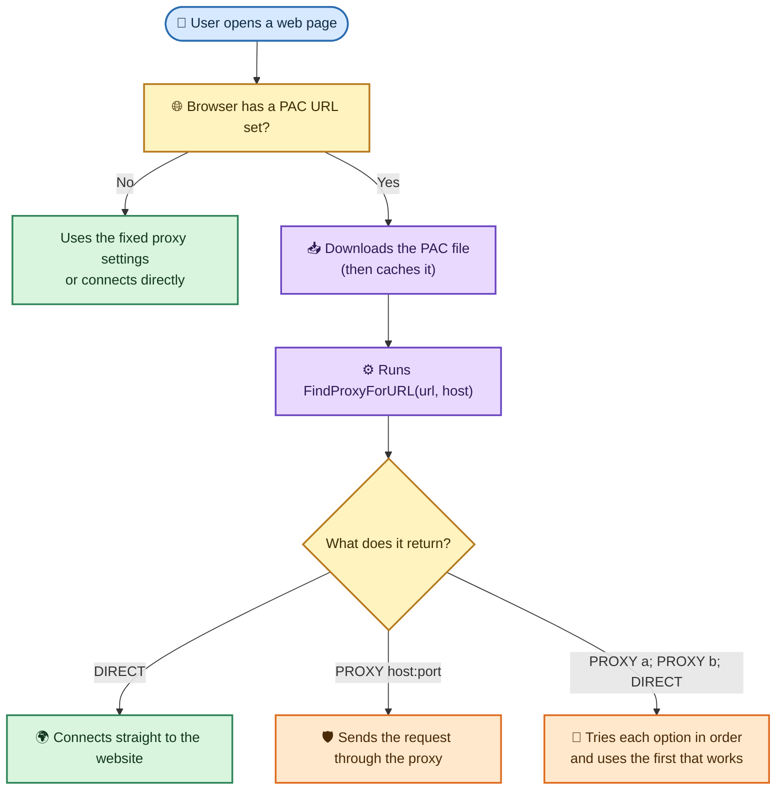
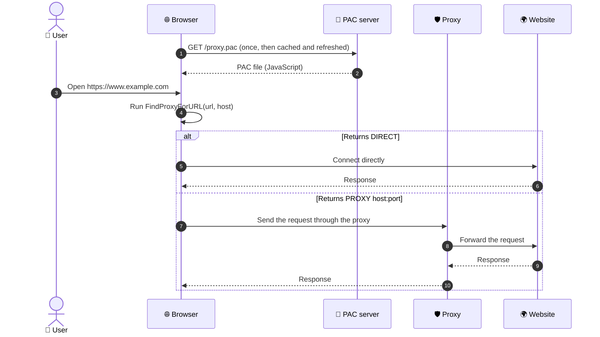
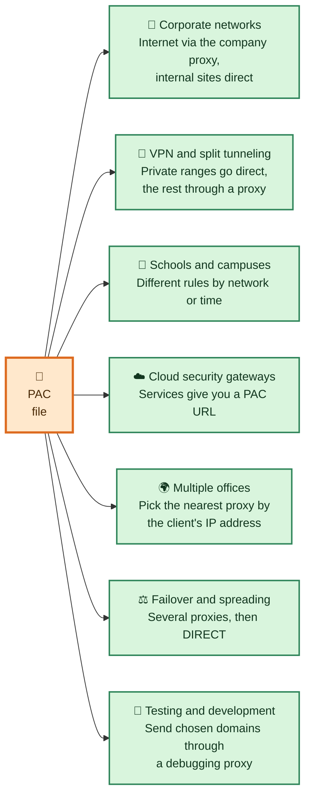
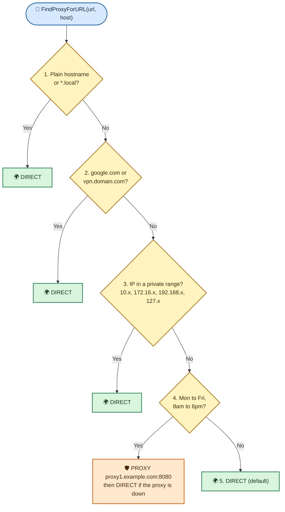

# PAC (Proxy Auto-Config) Functions

A browser that supports PAC exposes the helper functions defined in the original Netscape specification. Each browser runs a PAC file in a **sandbox** that allows only the JavaScript needed to pick a proxy. For example, a PAC file cannot read the browser's user-agent string, even though a normal web page can.

## Table of Contents

- [What is a PAC file?](#what-is-a-pac-file)
- [How PAC works](#how-pac-works)
- [Where PAC is used](#where-pac-is-used)
- [Deploying a PAC file](#deploying-a-pac-file)
- [Basic structure](#basic-structure)
- [Return values](#return-values)
- [Quick reference](#quick-reference)
- [Hostname and URL functions](#hostname-and-url-functions)
- [IP address functions](#ip-address-functions)
- [Time-based functions](#time-based-functions)
- [Unsupported functions](#unsupported-functions)
- [Complete example](#complete-example)
  - [How the complete example decides](#how-the-complete-example-decides)
- [Tips](#tips)
- [Common pitfalls and security](#common-pitfalls-and-security)
- [Related notes](#related-notes)

---

## What is a PAC file?

A **PAC (Proxy Auto-Config) file** is a small JavaScript file that tells a browser or operating system **which proxy to use for each web request**. Instead of one fixed proxy for everything, the PAC file decides per request, based on the URL, the hostname, the user's network, or even the time of day.

| | Fixed proxy setting | PAC file |
| :--- | :--- | :--- |
| **Decision** | Same proxy for every request | Chosen for each request by code |
| **Internal sites** | Need a manual exceptions list | Handled by rules, e.g. `isPlainHostName` |
| **Failover** | None | `"PROXY a; PROXY b; DIRECT"` |
| **Updates** | Change settings on every device | Change one file on a server |

## How PAC works

The browser downloads the PAC file once from a URL, then runs its `FindProxyForURL(url, host)` function for **every request**. The function returns a string that tells the browser how to connect.





Because the function runs in the browser for each request, it must be **fast**. A slow function, or a slow DNS lookup inside it, slows down every page.

## Where PAC is used



- 🏢 **Corporate networks:** Send internet traffic through the company proxy and keep internal sites (`intranet`, `*.corp.example.com`) on a direct connection. This is the most common use.
- 🔐 **VPN and split tunneling:** Keep private ranges (`10.x`, `172.16.x`, `192.168.x`) direct or on the VPN, and send everything else through a proxy.
- 🏫 **Schools and campuses:** Use different proxies or rules depending on the network the device is on, or on the time of day.
- ☁️ **Cloud security gateways:** Many cloud web-security services let you point devices at a hosted PAC URL, so traffic goes to their service.
- 🌍 **Multiple offices:** Use `myIpAddress()` and `isInNet()` to pick the closest proxy for each office.
- ⚖️ **Failover:** Return `"PROXY a; PROXY b; DIRECT"` so users keep working if one proxy is down.
- 🧪 **Testing and development:** Route only selected domains through a local debugging proxy while everything else goes direct.

## Deploying a PAC file

1. 📝 Save the file as `proxy.pac`.
2. 🌐 Host it on a web server that all clients can reach, such as `http://pac.example.com/proxy.pac`.
3. 📄 Serve it with the MIME type `application/x-ns-proxy-autoconfig`.
4. 🖥️ Tell the browsers or devices where to find it, using one of these methods:

| Method | How it works |
| :--- | :--- |
| ✋ **Manual setting** | In the browser or operating system proxy settings, turn on "Use setup script" or "Automatic proxy configuration URL" and enter the PAC URL. |
| 🔎 **WPAD (auto-discovery)** | Clients look for the file themselves, for example at `http://wpad.<your-domain>/wpad.dat`, found through DHCP or DNS. The file is a normal PAC file. |
| 🏢 **Group Policy or device management (MDM)** | Administrators push the PAC URL to all managed devices. |
| ⌨️ **Command line** | See the examples below. |

```bash
# macOS: set the PAC URL for the Wi-Fi network service
networksetup -setautoproxyurl "Wi-Fi" "http://pac.example.com/proxy.pac"

# Linux (GNOME)
gsettings set org.gnome.system.proxy mode 'auto'
gsettings set org.gnome.system.proxy autoconfig-url 'http://pac.example.com/proxy.pac'
```

> The host name and file name above are placeholders. Use your own server and URL.

---

## Basic structure

Every PAC file defines one function, `FindProxyForURL`. The browser calls it for each request.

```javascript
function FindProxyForURL(url, host) {
    // url:  the full URL, e.g. "http://www.example.com/path?query=1"
    // host: the hostname only, e.g. "www.example.com"

    if (isPlainHostName(host)) {
        return "DIRECT";
    }

    return "PROXY proxy1.example.com:8080";
}
```

## Return values

`FindProxyForURL` returns a string. You can chain several options with `;`, and the browser tries them in order.

| Value | Meaning |
|---|---|
| `DIRECT` | Connect straight to the Internet, with no proxy |
| `PROXY host:port` | Use an HTTP proxy |
| `SOCKS host:port` | Use a SOCKS proxy |

```javascript
// Try the proxy first; fall back to direct if it is unreachable.
return "PROXY proxy1.example.com:8080; DIRECT";
```

---

## Quick reference

| Function | Category | Returns | Use it to |
|---|---|---|---|
| [`dnsDomainIs(host, domain)`](#dnsdomainis) | Hostname | boolean | Match a domain name |
| [`shExpMatch(str, pattern)`](#shexpmatch) | Hostname / URL | boolean | Match a host or URL with wildcards |
| [`isPlainHostName(host)`](#isplainhostname) | Hostname | boolean | Detect names with no dots, e.g. `intranet` |
| [`localHostOrDomainIs(host, name)`](#localhostordomainis) | Hostname | boolean | Match an exact host, or its short name |
| [`dnsDomainLevels(host)`](#dnsdomainlevels) | Hostname | number | Count the dots in a hostname |
| [`isResolvable(host)`](#isresolvable) | DNS | boolean | Check whether DNS can resolve a host |
| [`dnsResolve(host)`](#dnsresolve) | DNS | string (IP) | Get the IP address of a host |
| [`myIpAddress()`](#myipaddress) | IP | string (IP) | Get the IP address of the local machine |
| [`isInNet(ip, pattern, mask)`](#isinnet) | IP | boolean | Check whether an IP is in a subnet |
| [`weekdayRange(...)`](#weekdayrange) | Time | boolean | Match days of the week |
| [`dateRange(...)`](#daterange) | Time | boolean | Match dates or months |
| [`timeRange(...)`](#timerange) | Time | boolean | Match hours of the day |
| [`alert(msg)`](#alert) | Debug | n/a | **Unsupported**, see below |

---

## Hostname and URL functions

### dnsDomainIs

Returns `true` if the hostname belongs to the given domain. Mainly used to match or exclude specific hostnames.

**Syntax:** `dnsDomainIs(host, domain)`

```javascript
// If the hostname matches google.com or www.google.com,
// send direct to the Internet.
if (dnsDomainIs(host, "google.com") || dnsDomainIs(host, "www.google.com"))
    return "DIRECT";
```

> **Tip:** The match is a suffix match, so use a leading dot to cover all subdomains: `dnsDomainIs(host, ".google.com")`.

### shExpMatch

Matches a hostname or URL against a shell expression (wildcards `*` and `?`). Returns `true` on a match.

**Syntax:** `shExpMatch(str, shell_expression)`

```javascript
// Any hostname ending in .local is sent direct.
if (shExpMatch(host, "*.local"))
    return "DIRECT";
```

```javascript
// The host vpn.domain.com, or any file or folder under
// http://abcdomain.com/folder/, is sent direct.
if (shExpMatch(host, "vpn.domain.com") ||
    shExpMatch(url, "http://abcdomain.com/folder/*"))
    return "DIRECT";
```

### isPlainHostName

Returns `true` if the hostname contains **no dots**, e.g. `http://intranet`. Useful for exempting internal sites without a DNS lookup.

**Syntax:** `isPlainHostName(host)`

```javascript
// Plain hostnames such as http://intranet/ or http://webserver-name01/
// are sent direct.
if (isPlainHostName(host))
    return "DIRECT";
```

### localHostOrDomainIs

Returns `true` only on an **exact** hostname match. It also matches the unqualified short name, so `www` matches `www.google.com`.

**Syntax:** `localHostOrDomainIs(host, hostdom)`

```javascript
// If the host is "www" or "www.google.com", send direct.
if (localHostOrDomainIs(host, "www.google.com"))
    return "DIRECT";
```

### dnsDomainLevels

Returns the number of DNS domain levels (number of dots) in the hostname. It can exempt internal sites that use short DNS names.

**Syntax:** `dnsDomainLevels(host)`

| Host | Result |
|---|---|
| `intranet` | `0` |
| `google.com` | `1` |
| `www.google.com` | `2` |

```javascript
// If the hostname contains any dots, use the proxy; otherwise go direct.
if (dnsDomainLevels(host) > 0)
    return "PROXY proxy1.example.com:8080";
else
    return "DIRECT";
```

---

## IP address functions

### isInNet

Returns `true` if an IP address falls inside the given subnet. If you pass a hostname, it is resolved to an IP address first.

**Syntax:** `isInNet(ip_or_host, pattern, mask)`

```javascript
// If the destination IP is in 172.16.0.0/12, send direct.
if (isInNet(dnsResolve(host), "172.16.0.0", "255.240.0.0"))
    return "DIRECT";
```

### myIpAddress

Returns the IP address of the machine running the browser, as a string.

**Syntax:** `myIpAddress()`

```javascript
// If the client is on the 10.10.1.0/24 network,
// send traffic through proxy 10.10.5.1 on port 8080.
if (isInNet(myIpAddress(), "10.10.1.0", "255.255.255.0"))
    return "PROXY 10.10.5.1:8080";
```

### dnsResolve

Resolves a hostname to an IP address. Store the result in a variable to avoid repeated DNS lookups.

**Syntax:** `dnsResolve(host)`

```javascript
// Resolve once, then check the result against several private ranges.
var ip = dnsResolve(host);

if (isInNet(ip, "10.0.0.0",    "255.0.0.0")   ||
    isInNet(ip, "172.16.0.0",  "255.240.0.0") ||
    isInNet(ip, "192.168.0.0", "255.255.0.0") ||
    isInNet(ip, "127.0.0.0",   "255.255.255.0"))
    return "DIRECT";
```

### isResolvable

Tries to resolve a hostname and returns `true` if it succeeds.

**Syntax:** `isResolvable(host)`

> **Warning:** The browser may hang for a while if a domain can't be resolved.

```javascript
// If DNS can resolve the host, use proxy1.example.com.
if (isResolvable(host))
    return "PROXY proxy1.example.com:8080";
```

---

## Time-based functions

These let rules depend on when the request is made. Times are in local time unless you pass `"GMT"` as the last argument.

### weekdayRange

Matches days of the week. Day names are `SUN MON TUE WED THU FRI SAT`.

**Syntax:** `weekdayRange(wd1, wd2, [gmt])`

```javascript
// Monday to Friday: use the proxy. Any other day: go direct.
if (weekdayRange("MON", "FRI"))
    return "PROXY proxy1.example.com:8080";
else
    return "DIRECT";
```

### dateRange

Matches dates or months. Month names are `JAN FEB MAR APR MAY JUN JUL AUG SEP OCT NOV DEC`.

**Syntax:** `dateRange(month1, month2, [gmt])`. It also accepts day and year forms.

```javascript
// January to March: use the proxy. Any other month: go direct.
if (dateRange("JAN", "MAR"))
    return "PROXY proxy1.example.com:8080";
else
    return "DIRECT";
```

### timeRange

Matches hours of the day, using the 24-hour clock.

**Syntax:** `timeRange(hour1, hour2, [gmt])`. It also accepts minute and second forms.

```javascript
// 8am to 6pm: use the proxy. Any other time: go direct.
if (timeRange(8, 18))
    return "PROXY proxy1.example.com:8080";
else
    return "DIRECT";
```

---

## Unsupported functions

### alert

`alert()` is **not part of the original PAC specification**. Several browsers once supported it for debugging, by showing a variable or function result to the user or in the error console. It is now considered **unsupported and non-functional** in PAC files.

```javascript
// Formerly printed the resolved IP address to the console. Don't rely on it.
var resolved_host = dnsResolve(host);
alert(resolved_host);
```

---

## Complete example

This combines several functions into one working PAC file.

```javascript
function FindProxyForURL(url, host) {

    // 1. Internal short names go direct.
    if (isPlainHostName(host) || shExpMatch(host, "*.local"))
        return "DIRECT";

    // 2. Specific sites that must bypass the proxy.
    if (dnsDomainIs(host, ".google.com") || shExpMatch(host, "vpn.domain.com"))
        return "DIRECT";

    // 3. Private networks go direct (resolve once to save DNS lookups).
    var ip = dnsResolve(host);
    if (ip && (isInNet(ip, "10.0.0.0",    "255.0.0.0")   ||
               isInNet(ip, "172.16.0.0",  "255.240.0.0") ||
               isInNet(ip, "192.168.0.0", "255.255.0.0") ||
               isInNet(ip, "127.0.0.0",   "255.0.0.0")))
        return "DIRECT";

    // 4. Office hours (Mon-Fri, 8am-6pm): use the proxy.
    if (weekdayRange("MON", "FRI") && timeRange(8, 18))
        return "PROXY proxy1.example.com:8080; DIRECT";

    // 5. Default.
    return "DIRECT";
}
```

### How the complete example decides



The first rule that matches returns, so later rules are never reached.

## Tips

- **Order matters:** The first rule that returns wins, so put the cheapest and most specific checks first.
- **Avoid DNS where you can:** `isPlainHostName` and `shExpMatch` need no lookup, while `dnsResolve`, `isResolvable` and `isInNet` with a hostname do.
- **Cache lookups:** Call `dnsResolve(host)` once and reuse the variable.
- **Always end with a default:** Finish with a `return` so every request gets an answer.
- **Provide a fallback:** Use `"PROXY host:port; DIRECT"` so users aren't cut off if the proxy goes down.
- **Debugging:** `alert()` doesn't work, so test with a PAC tester or the browser's network and proxy logs.

## Common pitfalls and security

| | Pitfall | What to do |
| :-: | :--- | :--- |
| 🐢 | **Slow DNS lookups** | `dnsResolve`, `isResolvable` and `isInNet` with a hostname can stall browsing. Put name-only checks first and resolve once. |
| 🗃️ | **Caching** | Browsers cache the PAC file and its results, so changes may take time to appear. Restart the browser or wait for the refresh. |
| 🔒 | **HTTPS URLs** | Some browsers hide the path and query of HTTPS URLs from the PAC file. Rules that match the path (for example `shExpMatch(url, "https://example.com/folder/*")`) may not work. Match the host name instead. |
| 🕳️ | **Missing default** | If the function ends without a `return`, behavior is undefined. Always end with a default. |
| 🎣 | **WPAD hijacking** | On an untrusted network, an attacker who answers WPAD lookups could point clients at a malicious PAC file. Prefer an explicit PAC URL over auto-discovery. |
| 🌐 | **Open hosting** | Anyone who can edit the PAC file can redirect your users' traffic. Restrict write access to the file and serve it over a trusted network. |

## Related notes

- 🗂️ [Proxy overview](../Proxy/README.md)
- ➡️ [Forward Proxy](../Proxy/Forward%20Proxy/README.md): the kind of proxy a PAC file chooses.
- 🕵️ [MITM Proxy](../Proxy/MITM%20Proxy/INSTALL_CA.md): often used as a debugging proxy with PAC rules.
