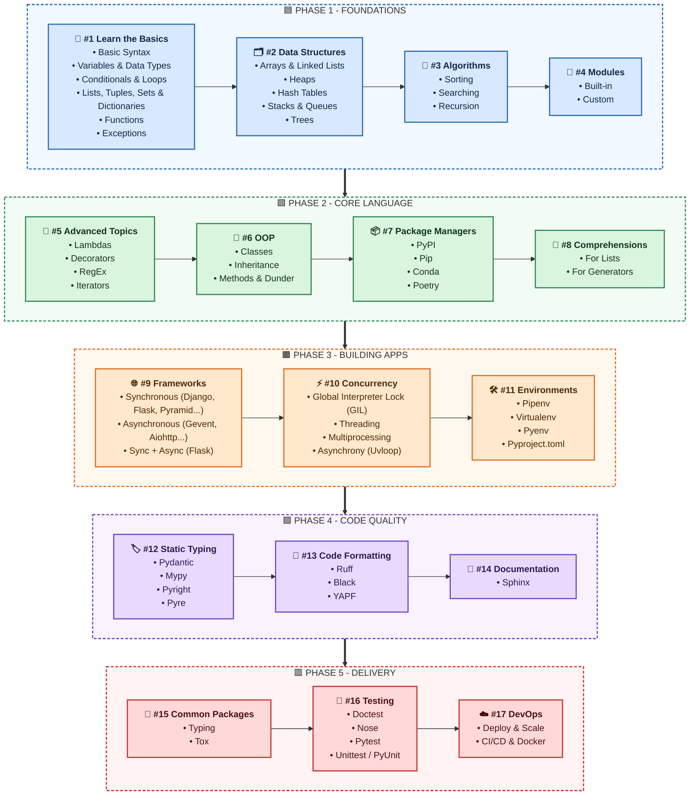

# 🐍 Getting Started with Python - Roadmap

## Table of Contents

- [Roadmap at a Glance](#roadmap-at-a-glance)
- [Roadmap Diagram](#roadmap-diagram)
- [Step-by-Step Details](#step-by-step-details)

## Roadmap at a Glance

The 17 steps follow the numbering of the original roadmap. The five phases below are only a grouping to make it easier to read.

| Phase | Steps | Focus |
| :--- | :--- | :--- |
| 🟦 **Phase 1 - Foundations** | #1 - #4 | Basics, data structures, algorithms, modules |
| 🟩 **Phase 2 - Core Language** | #5 - #8 | Advanced topics, OOP, package managers, comprehensions |
| 🟧 **Phase 3 - Building Apps** | #9 - #11 | Frameworks, concurrency, environments |
| 🟪 **Phase 4 - Code Quality** | #12 - #14 | Static typing, code formatting, documentation |
| 🟥 **Phase 5 - Delivery** | #15 - #17 | Common packages, testing, DevOps |

## Roadmap Diagram

## Step-by-Step Details

| # | Step | What to learn |
| :-: | :--- | :--- |
| 1 | 🧱 **Learn the Basics** | Basic Syntax, Variables & Data Types, Conditionals & Loops, Lists, Tuples, Sets & Dictionaries, Functions, Exceptions |
| 2 | 🗂️ **Data Structures** | Arrays & Linked Lists, Heaps, Hash Tables, Stacks & Queues, Trees |
| 3 | 🧮 **Algorithms** | Sorting, Searching, Recursion |
| 4 | 🧩 **Modules** | Built-in, Custom |
| 5 | 🚀 **Advanced Topics** | Lambdas, Decorators, RegEx, Iterators |
| 6 | 🧬 **OOP** | Classes, Inheritance, Methods & Dunder |
| 7 | 📦 **Package Managers** | PyPI, Pip, Conda, Poetry |
| 8 | 🔗 **Comprehensions** | For Lists, For Generators |
| 9 | 🌐 **Frameworks** | Synchronous (Django, Flask, Pyramid...), Asynchronous (Gevent, Aiohttp...), Sync + Async (Flask) |
| 10 | ⚡ **Concurrency** | Global Interpreter Lock (GIL), Threading, Multiprocessing, Asynchrony (Uvloop) |
| 11 | 🛠️ **Environments** | Pipenv, Virtualenv, Pyenv, Pyproject.toml |
| 12 | 🏷️ **Static Typing** | Pydantic, Mypy, Pyright, Pyre |
| 13 | 🎨 **Code Formatting** | Ruff, Black, YAPF |
| 14 | 📝 **Documentation** | Sphinx |
| 15 | 🎁 **Common Packages** | Typing, Tox |
| 16 | 🧪 **Testing** | Doctest, Nose, Pytest, Unittest / PyUnit |
| 17 | ☁️ **DevOps** | Deploy & Scale, CI/CD & Docker |
