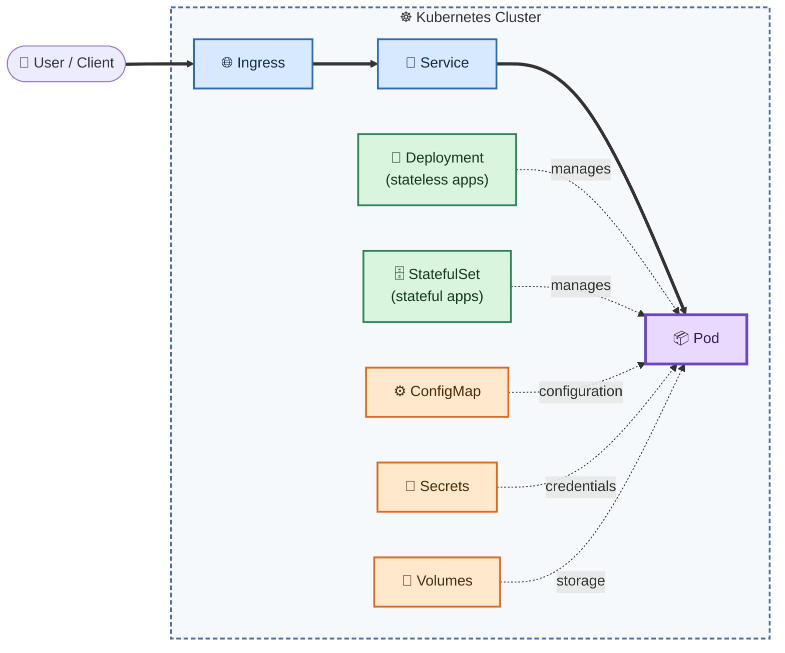
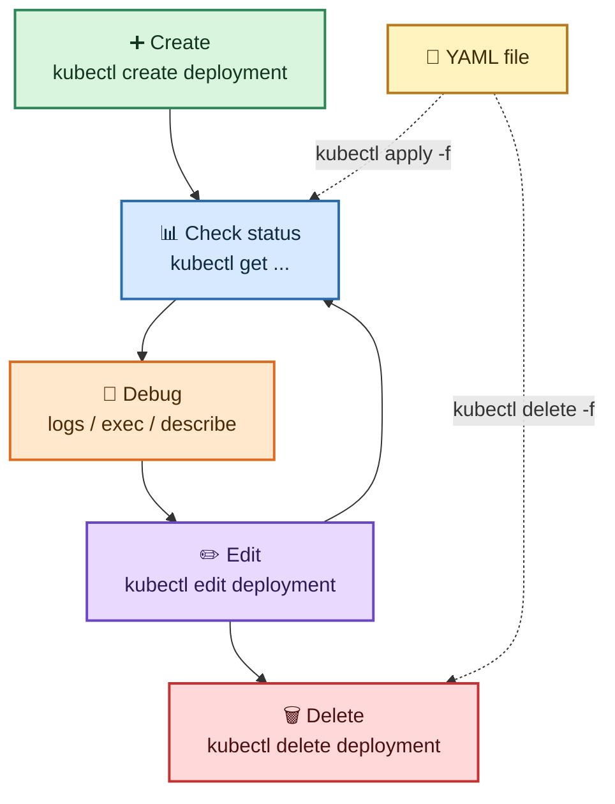
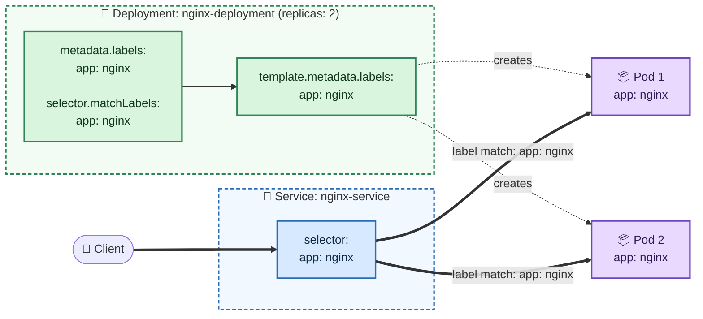

# ☸️ Kubernetes (K8S)

---

The ```Kubernetes (K8S)``` contains various learning materials.


## Table of Contents

---

- [Main Kubernetes Components](#main-kubernetes-components)
- [Basic kubectl Commands](#basic-kubectl-commands)
  - [CRUD Commands](#crud-commands)
  - [Status of Different K8s Components](#status-of-different-k8s-components)
  - [Debugging Pods](#debugging-pods)
  - [Use Configuration File for CRUD](#use-configuration-file-for-crud)
- [Connecting Services to Deployments](#connecting-services-to-deployments)


## Main Kubernetes Components

---

Main Kubernetes components summarized:

| | Component | Purpose |
| :-: | :--- | :--- |
| 📦 | **Pod** | The smallest deployable unit. It runs one or more containers. |
| 🔀 | **Service** | A stable network endpoint that load balances traffic to a set of Pods. |
| 🌐 | **Ingress** | Routes external HTTP/HTTPS traffic to Services. |
| 🚀 | **Deployment** | Manages stateless Pods: replicas, rolling updates and rollbacks. |
| 🗄️ | **StatefulSet** | Manages stateful Pods that need a stable identity and storage. |
| 💾 | **Volumes** | Storage that Pods can mount. |
| ⚙️ | **ConfigMap** | External, non-sensitive configuration for Pods. |
| 🔐 | **Secrets** | Sensitive data such as passwords, tokens and keys. |

> The component list comes from the original image. The "Purpose" column and the diagram below are added explanations.

### How the Components Fit Together



| Color | Meaning |
| :-: | :--- |
| 🟦 | Networking: Ingress and Service |
| 🟩 | Workload controllers: Deployment and StatefulSet |
| 🟧 | Configuration and storage: ConfigMap, Secrets and Volumes |
| 🟪 | The Pod that everything else connects to |


## Basic kubectl Commands

---

Create and debug Pods in a minikube cluster.



### CRUD Commands

| Action | Command |
| :--- | :--- |
| ➕ Create deployment | `kubectl create deployment [name]` |
| ✏️ Edit deployment | `kubectl edit deployment [name]` |
| 🗑️ Delete deployment | `kubectl delete deployment [name]` |

### Status of Different K8s Components

```bash
kubectl get nodes | pod | services | replicaset | deployment
```

> `|` means "or": run the command with one resource type at a time, for example `kubectl get pod`.

| Resource | Command |
| :--- | :--- |
| 🖥️ Nodes | `kubectl get nodes` |
| 📦 Pods | `kubectl get pod` |
| 🔀 Services | `kubectl get services` |
| 🔁 ReplicaSets | `kubectl get replicaset` |
| 🚀 Deployments | `kubectl get deployment` |

### Debugging Pods

| Action | Command |
| :--- | :--- |
| 📜 Log to console | `kubectl logs [pod name]` |
| 💻 Get interactive terminal | `kubectl exec -it [pod name] -- bin/bash` |
| 🔍 Get info about pod | `kubectl describe pod [pod name]` |

### Use Configuration File for CRUD

| Action | Command |
| :--- | :--- |
| ✅ Apply a configuration file | `kubectl apply -f [file name]` |
| 🗑️ Delete with configuration file | `kubectl delete -f [file name]` |


## Connecting Services to Deployments

---

The Service's `selector` (`app: nginx`) must match the labels of the Deployment's Pods, so the Service knows which Pods to route traffic to. In the original diagram, the arrows point from the Service's `app: nginx` selector to the Deployment's `app: nginx` labels (lines 6 and 15).



**Deployment**

```yaml
apiVersion: apps/v1
kind: Deployment
metadata:
  name: nginx-deployment
  labels:
    app: nginx                # <-- label (line 6)
spec:
  replicas: 2
  selector:
    matchLabels:
      app: nginx
  template:
    metadata:
      labels:
        app: nginx            # <-- Pod label (line 15)
    spec: ...   # collapsed in the original image
```

**Service**

```yaml
apiVersion: v1
kind: Service
metadata:
  name: nginx-service
spec:
  selector:
    app: nginx                # <-- must match the labels above
  ports: ...   # collapsed in the original image
```


# Author

---

- [Rohtash Lakra](https://github.com/rslakra)
