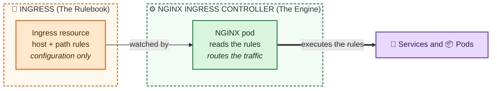
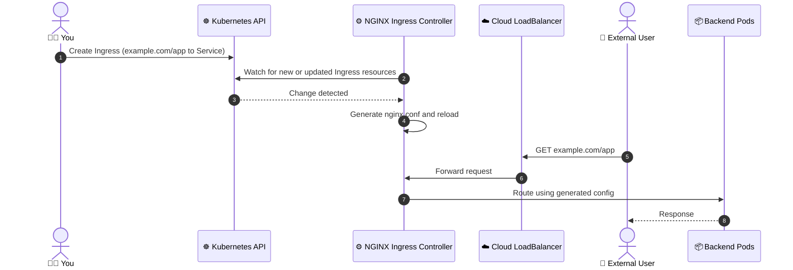
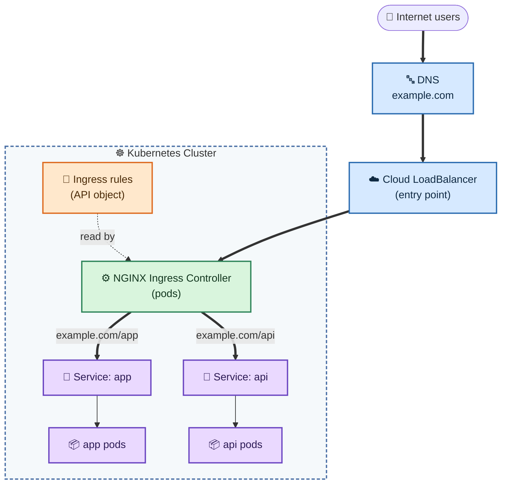
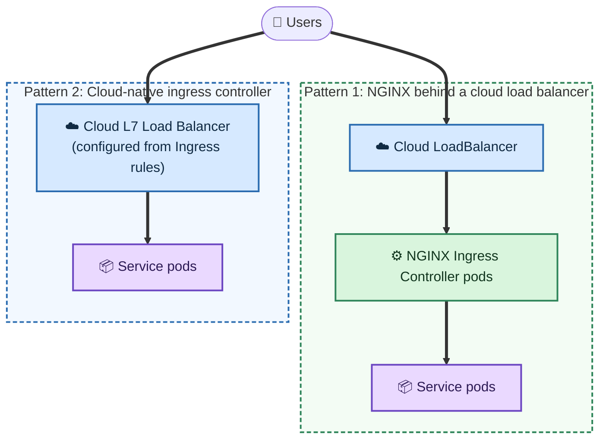
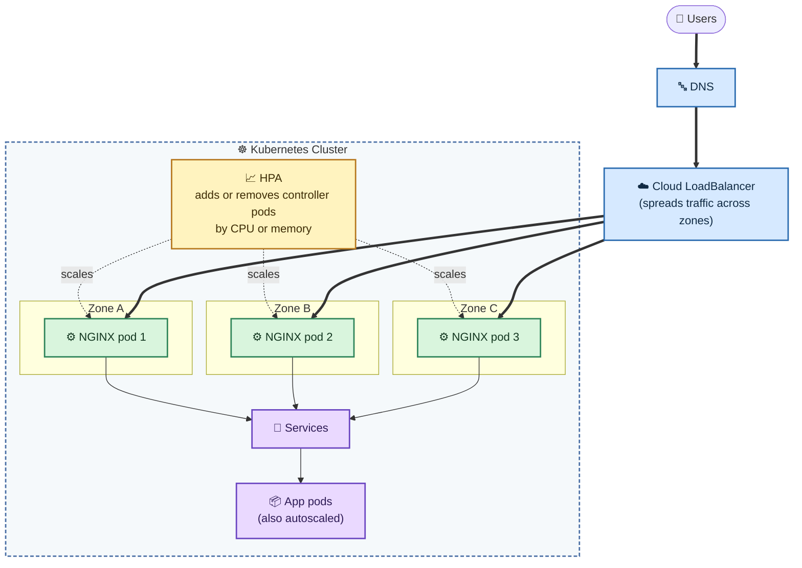
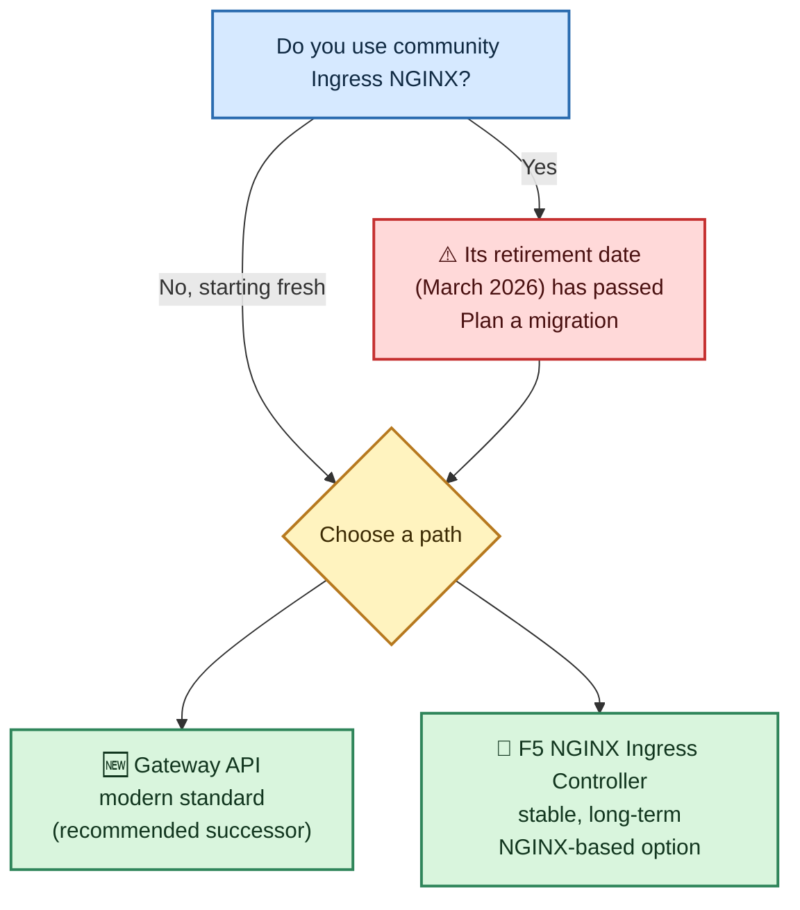
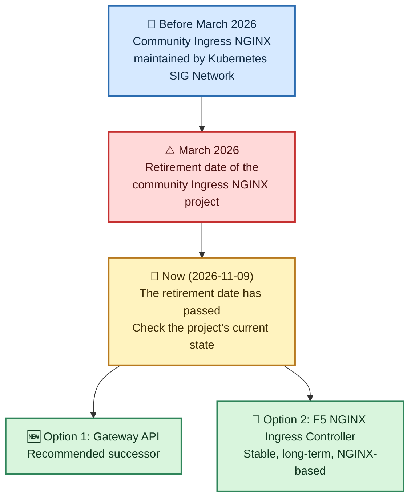

# 🌐 Ingress vs NGINX

In Kubernetes, **Ingress is an API object that defines rules for external traffic, while NGINX (as an Ingress Controller) is the actual software that executes those rules.**

## Table of Contents

- [Core Differences](#core-differences)
- [How They Work Together](#how-they-work-together)
- [Where Each Component Is Used](#where-each-component-is-used)
- [Benefits](#benefits)
- [Example Ingress Manifest](#example-ingress-manifest)
- [Ingress and NGINX in the Cloud](#ingress-and-nginx-in-the-cloud)
- [Making It Scalable](#making-it-scalable)
- [Important Updates](#important-updates)

> The original image covers Core Differences, How They Work Together and Important Updates. The diagrams, the usage and benefits sections, the example, and the cloud and scaling sections are added explanations.

---

## Core Differences

| | 📜 Ingress | ⚙️ NGINX Ingress Controller |
| :--- | :--- | :--- |
| **Role** | The Rulebook | The Engine |
| **What it is** | A Kubernetes resource (API object) | A specialized pod running NGINX |
| **What it does** | Describes how HTTP/HTTPS traffic should reach internal services | "Watches" the Ingress rules and configures its internal engine to route traffic accordingly |
| **Can route traffic on its own?** | No, it is just a configuration file | Yes, it is the software that actually routes traffic |

- **Ingress (The Rulebook):** A Kubernetes resource that describes how HTTP/HTTPS traffic should reach internal services. It is just a configuration file and cannot route traffic on its own.
- **NGINX Ingress Controller (The Engine):** A specialized pod running NGINX that "watches" the Ingress rules and configures its internal engine to route traffic accordingly.



## How They Work Together

1. **Rule Definition:** You create an `Ingress` manifest specifying that traffic for `example.com/app` should go to a specific internal `Service`.
2. **Monitoring:** The **NGINX Ingress Controller** constantly monitors the Kubernetes API for new or updated Ingress resources.
3. **Configuration Generation:** When a change is detected, the controller automatically converts your Ingress rules into an `nginx.conf` file.
4. **Traffic Routing:** External traffic hits the NGINX controller (usually through a cloud LoadBalancer), which then uses its generated configuration to forward requests to the correct backend pods.



## Where Each Component Is Used



| Component | Where it lives | Used for |
| :--- | :--- | :--- |
| 📜 **Ingress** | In the cluster, as an API object (YAML manifest) | Declaring host and path routing rules, and TLS settings |
| ⚙️ **NGINX Ingress Controller** | In the cluster, as pods (usually in their own namespace) | Reading the rules and routing the traffic |
| ☁️ **Cloud LoadBalancer** | Outside the cluster, in the cloud provider | The public entry point that sends traffic to the controller |
| 🔀 **Service** | In the cluster | A stable address in front of the backend pods |

## Benefits

- 🔗 **One entry point:** Many applications share a single external IP or load balancer, which saves cost compared with one LoadBalancer per Service.
- 🧭 **Host and path routing:** `example.com/app` and `example.com/api` can go to different Services.
- 🔒 **Central TLS termination:** Certificates are managed in one place instead of in every application.
- 📝 **Declarative and versioned:** The routing rules are YAML, so they can be reviewed and stored in Git.
- 🔄 **Automatic updates:** The controller regenerates `nginx.conf` when rules change, so there are no manual edits.
- ⚡ **Extra features:** Depending on configuration, the controller can add rewrites, rate limiting, authentication, timeouts and more.

## Example Ingress Manifest

```yaml
apiVersion: networking.k8s.io/v1
kind: Ingress
metadata:
  name: app-ingress
spec:
  ingressClassName: nginx          # handled by the NGINX Ingress Controller
  tls:
    - hosts:
        - example.com
      secretName: example-com-tls  # TLS certificate stored as a Secret
  rules:
    - host: example.com
      http:
        paths:
          - path: /app
            pathType: Prefix
            backend:
              service:
                name: app-service
                port:
                  number: 80
```

Install the NGINX controller with Helm:

```bash
helm upgrade --install ingress-nginx ingress-nginx/ingress-nginx \
  --namespace ingress-nginx --create-namespace
```

> Before installing, check the retirement notice in [Important Updates](#important-updates).

## Ingress and NGINX in the Cloud

In managed Kubernetes, there are two common patterns:

1. **NGINX behind a cloud load balancer:** The controller runs in the cluster, and the cloud provider creates a load balancer in front of it. This works the same way on every cloud.
2. **Cloud-native ingress controller:** The cloud's own load balancer reads the Ingress rules directly, with no NGINX pods.



| Cloud | NGINX behind a cloud load balancer | Cloud-native alternative |
| :--- | :--- | :--- |
| ☁️ **AWS (EKS)** | NGINX Ingress Controller behind a Network Load Balancer (NLB) | AWS Load Balancer Controller creates an Application Load Balancer (ALB) from Ingress rules |
| ☁️ **Google Cloud (GKE)** | NGINX Ingress Controller behind a Google Cloud load balancer | GKE Ingress creates a Google Cloud Application Load Balancer |
| ☁️ **Azure (AKS)** | NGINX Ingress Controller behind an Azure Load Balancer | Application Gateway Ingress Controller (AGIC) uses Azure Application Gateway |

> Check each provider's current documentation for exact names and setup steps, because these products change over time.

## Making It Scalable



Practical tips for a scalable setup:

- ⚙️ **Run several controller replicas** (at least 2) so there is no single point of failure. All replicas read the same Ingress rules.
- 🌍 **Spread the replicas across zones** with pod anti-affinity or topology spread constraints.
- 📈 **Autoscale the controller** with a Horizontal Pod Autoscaler (HPA), for example:

  ```bash
  kubectl autoscale deployment ingress-nginx-controller -n ingress-nginx \
    --cpu-percent=70 --min=2 --max=10
  ```

- 🛡️ **Add a PodDisruptionBudget** so upgrades and node drains don't remove all controller pods at once.
- 📈 **Autoscale the backend apps** too, so the whole path scales and not just the entry point.
- ☁️ **Let the cloud load balancer handle the front door.** It is managed, highly available and spreads traffic across zones.

## Important Updates

> 🗓️ **Last reviewed:** 2026-11-09
>
> Add new entries to the [Changelog](#changelog-newest-first) and the [Timeline](#timeline), then update the date above.

### Summary from the Source

- **Retirement:** The community **Ingress NGINX** project (maintained by Kubernetes SIG Network) is being retired as of **March 2026**.
- **Successor:** Users are encouraged to migrate to the **Gateway API**, a more modern standard for traffic management.
- **Commercial Alternative:** The F5 NGINX Ingress Controller remains a stable, long-term alternative for those who wish to continue using NGINX-based ingress in production.

### Current Status

As of 2026-11-09:

| Item | Status | Notes |
| :--- | :--- | :--- |
| 🔴 **Community Ingress NGINX** (Kubernetes SIG Network) | Retirement date was **March 2026**, and that date has passed | Check the project's repository for its current state before using it in new setups. |
| 🟢 **Gateway API** | Recommended successor | A more modern standard for traffic management. |
| 🟢 **F5 NGINX Ingress Controller** | Stable, long-term alternative | For teams that want to keep using NGINX-based ingress in production. |

> This status comes from the source image plus today's date. It is not checked against the projects' own announcements.

### Options Compared

| | 🔴 Community Ingress NGINX | 🟢 Gateway API | 🟢 F5 NGINX Ingress Controller |
| :--- | :--- | :--- | :--- |
| **What it is** | An Ingress controller | A newer API standard for traffic management | An Ingress controller from F5 |
| **Maintained by** | Kubernetes SIG Network | Kubernetes SIG Network | F5 |
| **Main objects** | `Ingress` | `GatewayClass`, `Gateway`, `HTTPRoute` | `Ingress` (plus its own extensions) |
| **Status** | Retirement date: March 2026 | Recommended successor | Stable, long-term |
| **Good fit for** | Existing clusters that are planning to migrate | New setups and migrations | Teams that want to stay on NGINX |

### Decision Guide



### Timeline

Read this from top to bottom. It shows what happened to the community Ingress NGINX project and where you can go next.



### Changelog (Newest First)

<!-- Add a new "#### YYYY" section for the next year above 2026 -->

#### 2026

- **Section reviewed:** The March 2026 retirement date has now passed. Check the current state of the community project before new installs.
- **Community Ingress NGINX retirement:** The project is scheduled to retire in March 2026. Plan a move to Gateway API, or to F5 NGINX Ingress Controller if you want to stay on NGINX. *(Source: original image)*
