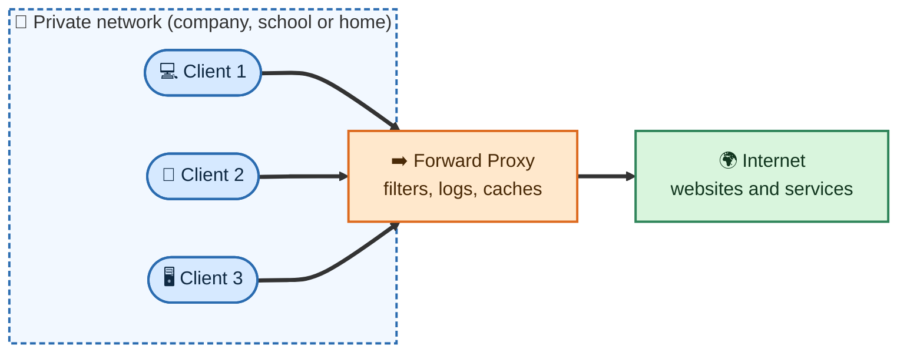
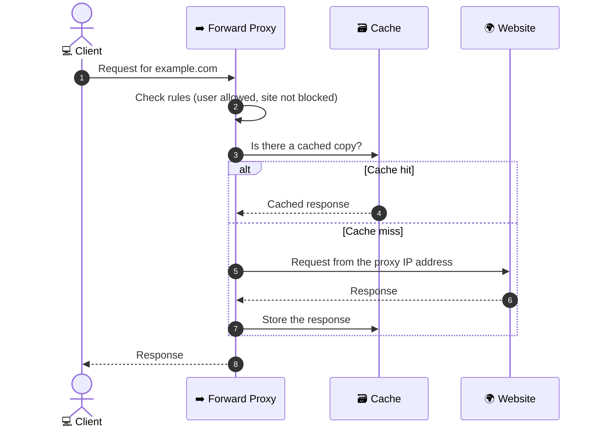
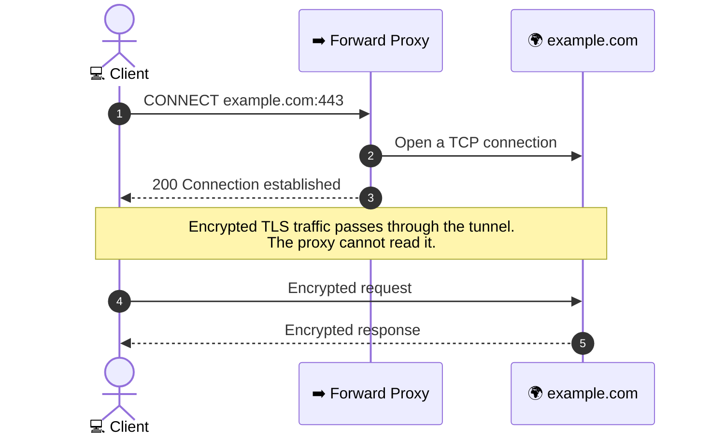
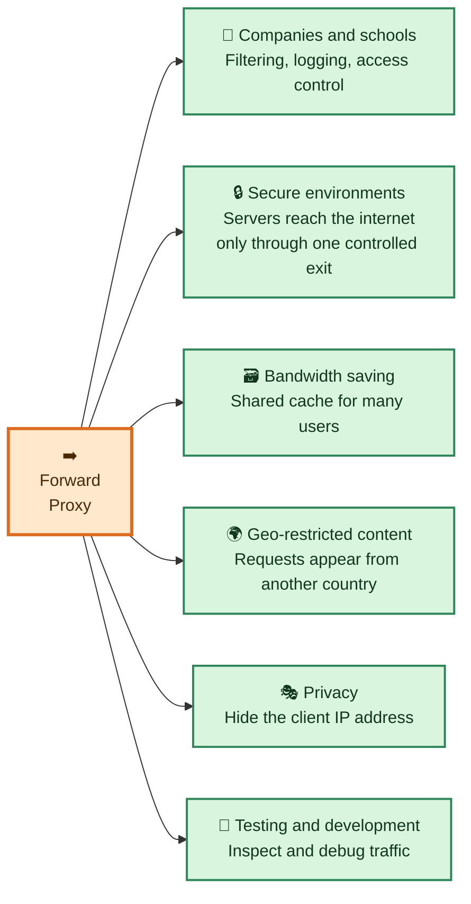
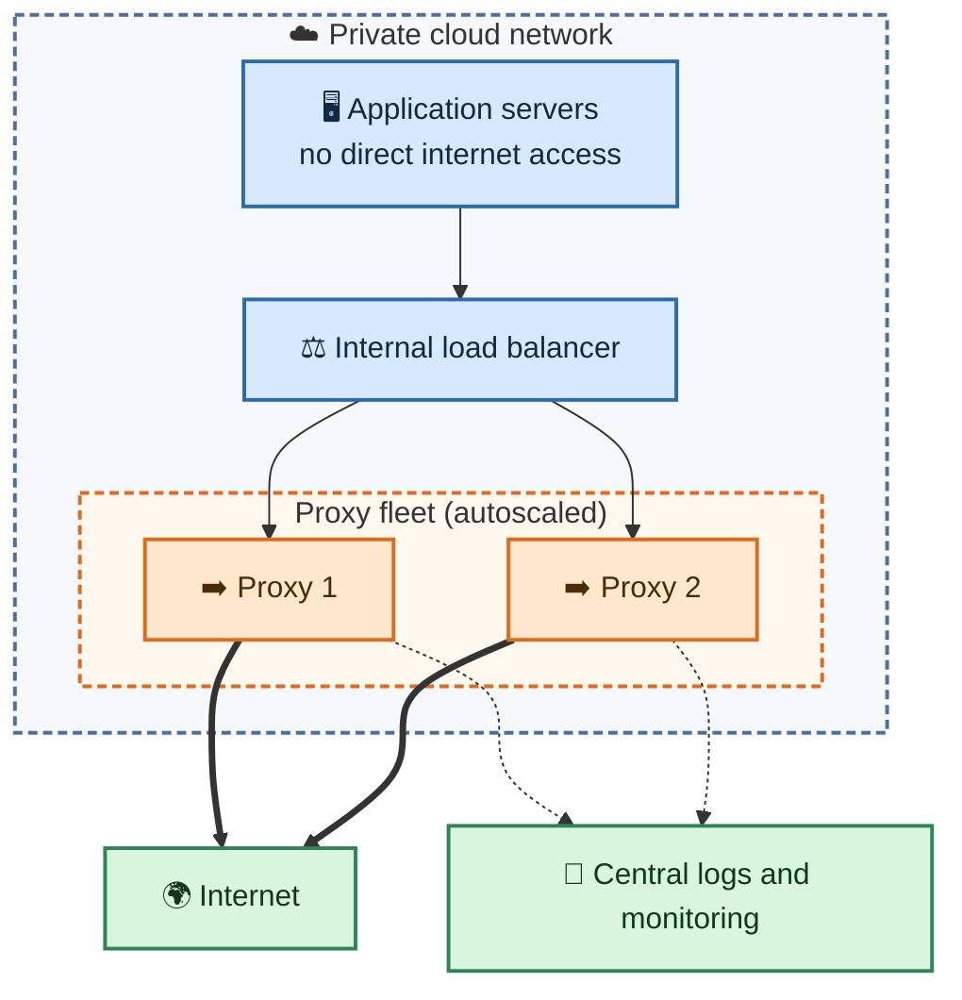

# ➡️ Forward Proxy

A **forward proxy** is a server that sits in front of **clients**. Instead of connecting to websites directly, clients send their requests to the proxy, and the proxy requests the content from the internet on their behalf. The websites see the proxy, not the individual client.

## Table of Contents

- [How a Forward Proxy Works](#how-a-forward-proxy-works)
- [HTTP vs HTTPS Through a Forward Proxy](#http-vs-https-through-a-forward-proxy)
- [Forward Proxy vs Reverse Proxy](#forward-proxy-vs-reverse-proxy)
- [What a Forward Proxy Does](#what-a-forward-proxy-does)
- [Where Forward Proxies Are Used](#where-forward-proxies-are-used)
- [Popular Forward Proxies](#popular-forward-proxies)
- [Example: Squid and Client Setup](#example-squid-and-client-setup)
- [Forward Proxy in the Cloud and at Scale](#forward-proxy-in-the-cloud-and-at-scale)
- [Related Notes](#related-notes)

---

## How a Forward Proxy Works



Step by step:

1. 💻 The client is **configured** to use the proxy, for example in the browser, the operating system or an environment variable.
2. ➡️ The client sends its request to the proxy instead of to the website.
3. 🛡️ The proxy checks its rules: is this user allowed, is this site blocked, is there a cached copy?
4. 🌍 If allowed, the proxy sends the request to the website using **its own** IP address.
5. ⬅️ The website responds to the proxy.
6. 📤 The proxy returns the response to the client, and may cache it for the next request.



## HTTP vs HTTPS Through a Forward Proxy

- **HTTP:** The proxy can read the whole request and response, so it can filter and cache the content.
- **HTTPS:** The client asks the proxy to open a tunnel with the `CONNECT` method. After that the traffic is encrypted end to end, so the proxy can see only the destination host and port, not the content.



> To inspect HTTPS content, the proxy has to decrypt it. That is what a MITM proxy does. See [MITM Proxy](../MITM%20Proxy/INSTALL_CA.md).

## Forward Proxy vs Reverse Proxy

| | ➡️ Forward proxy | 🔁 Reverse proxy |
| :--- | :--- | :--- |
| **Sits in front of** | Clients | Servers |
| **Works for** | The client side | The server side |
| **Hides** | The clients from websites | The servers from clients |
| **Client knows about it?** | Yes, the client must be configured | Usually not |
| **Set up by** | A company, school or user | The site owner |
| **Typical uses** | Content filtering, access control, caching, anonymity | Load balancing, TLS termination, caching, protection |

See [Reverse Proxy](../Reverse%20Proxy/README.md) for the server-side version.

## What a Forward Proxy Does

| | Function | What it means |
| :-: | :--- | :--- |
| 🚧 | **Content filtering** | Blocks sites or categories (for example social media or malware domains). |
| 🔐 | **Access control** | Allows only certain users or networks to reach the internet. |
| 📝 | **Logging and auditing** | Records who accessed what, for security and compliance. |
| 🗃️ | **Caching** | Keeps copies of popular content so repeated requests are faster and use less bandwidth. |
| 🎭 | **Hiding client IPs** | Websites see the proxy IP address, not each client's IP address. |
| 🌍 | **Changing apparent location** | Requests appear to come from the proxy's location. |
| 🛡️ | **Malware scanning** | Some proxies scan downloads before they reach the client. |

## Where Forward Proxies Are Used



- 🏢 **Companies and schools:** Control and record what users can reach on the internet.
- 🔒 **Secure environments:** Application servers in a private network can only reach the outside world through the proxy. This lets security teams allow only approved destinations (an "egress proxy").
- 🗃️ **Bandwidth saving:** A shared cache serves repeated downloads, such as software updates, to many users.
- 🌍 **Geo-restricted content:** A proxy in another region can make requests appear to come from there.
- 🎭 **Privacy:** Hides the client's IP address. For stronger anonymity, see [High Anonymity Proxy](../High%20Anonymity%20Proxy/README.md).
- 🧪 **Testing and development:** Developers use proxies to see and debug the traffic of an app.

## Popular Forward Proxies

| Type | Examples |
| :--- | :--- |
| 🧰 **Software you run yourself** | Squid, Tinyproxy, Privoxy, Apache HTTP Server (`mod_proxy`) |
| ☁️ **Managed and security services** | Secure web gateways such as Zscaler, Cisco Umbrella and Netskope |
| 🧪 **Developer tools** | mitmproxy, Charles Proxy, Fiddler |

## Example: Squid and Client Setup

A small Squid configuration that allows a private network, blocks one domain and denies everyone else:

```text
# Listen on port 3128
http_port 3128

# Define who and what
acl localnet src 10.0.0.0/8
acl blocked_sites dstdomain .blocked-example.com

# Rules are checked from top to bottom
http_access deny blocked_sites
http_access allow localnet
http_access deny all
```

Use the proxy from a client:

```bash
# One command
curl -x http://proxy.example.com:3128 https://example.com

# For the current shell session
export http_proxy=http://proxy.example.com:3128
export https_proxy=http://proxy.example.com:3128
```

| Setting | Purpose |
| :--- | :--- |
| `http_port` | The port the proxy listens on. Clients connect to it. |
| `acl` | Names a group of clients or destinations. |
| `http_access` | Allows or denies requests. The first matching rule wins, so order matters. |
| `curl -x` | Sends a single request through the proxy. |
| `http_proxy` and `https_proxy` | Many tools read these variables and use the proxy automatically. |

> The addresses, ports and domains above are placeholders. Replace them with your own values.

## Forward Proxy in the Cloud and at Scale



Tips for a reliable and scalable setup:

- ⚙️ **Run at least two proxy instances** behind a load balancer so there is no single point of failure.
- 📈 **Autoscale** the proxy fleet based on connections and bandwidth.
- 🚪 **Use one controlled exit:** Put application servers in private subnets with no direct internet route, so all outbound traffic goes through the proxy.
- ✅ **Use an allowlist** of approved destinations where possible.
- 📝 **Send logs to a central place** for auditing and troubleshooting.
- 🗃️ **Cache** large, repeated downloads such as OS and package updates.

## Related Notes

- 🗂️ [Proxy overview](../README.md)
- 🔁 [Reverse Proxy](../Reverse%20Proxy/README.md): the server-side counterpart.
- 🎭 [High Anonymity Proxy](../High%20Anonymity%20Proxy/README.md): a forward proxy that hides your identity.
- 🕵️ [MITM Proxy](../MITM%20Proxy/INSTALL_CA.md): a proxy that decrypts HTTPS traffic.
