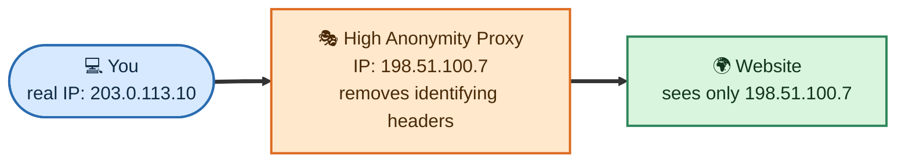
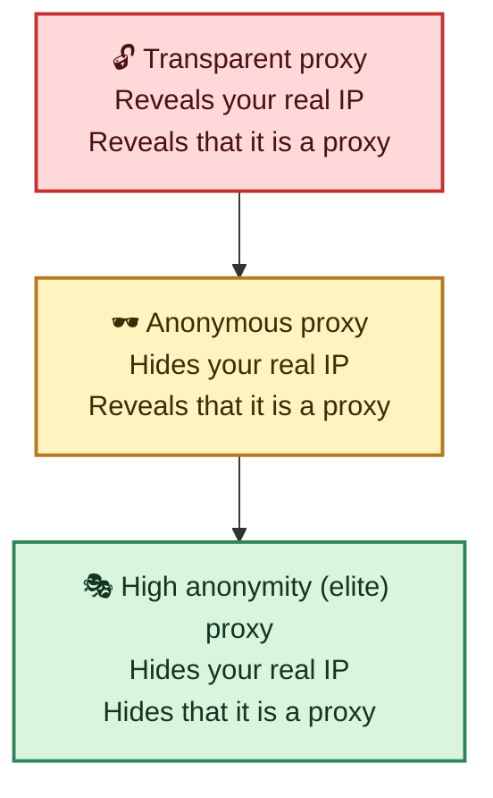
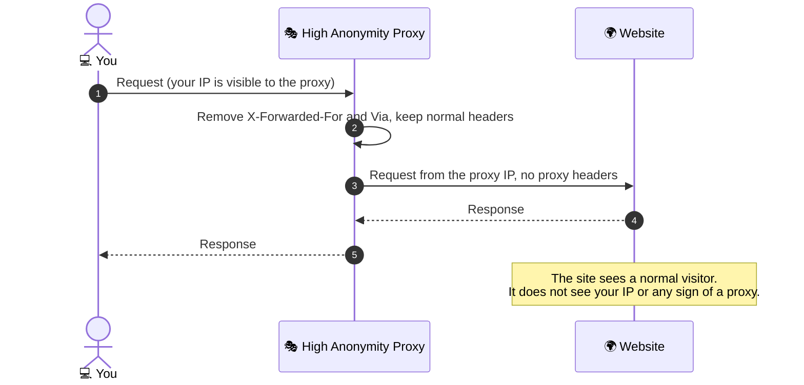
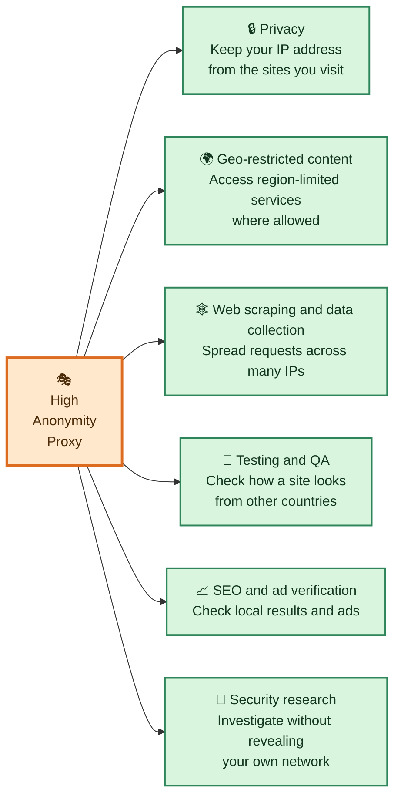

# 🎭 High Anonymity Proxy

A **high anonymity proxy** (also called an **elite proxy**) is a forward proxy that hides both your real IP address **and the fact that you are using a proxy at all**. The website sees an ordinary request coming from the proxy's IP address, with no headers that reveal a proxy or your original address.

## Table of Contents

- [How a High Anonymity Proxy Works](#how-a-high-anonymity-proxy-works)
- [Levels of Anonymity](#levels-of-anonymity)
- [What the Website Sees](#what-the-website-sees)
- [Where High Anonymity Proxies Are Used](#where-high-anonymity-proxies-are-used)
- [What a Proxy Does Not Hide](#what-a-proxy-does-not-hide)
- [High Anonymity Proxy vs VPN vs Tor](#high-anonymity-proxy-vs-vpn-vs-tor)
- [Choosing and Using One Safely](#choosing-and-using-one-safely)
- [Related Notes](#related-notes)

---

## How a High Anonymity Proxy Works

> The IP addresses above are documentation examples, not real addresses.

Step by step:

1. 💻 You send your request to the proxy.
2. 🧹 The proxy **removes** headers that would reveal you or the proxy, such as `X-Forwarded-For` and `Via`.
3. 🌍 The proxy sends the request to the website from **its own** IP address.
4. 👀 The website sees what looks like a normal visitor, and has no sign that a proxy was used.
5. 📤 The proxy returns the response to you.

## Levels of Anonymity

Proxies are usually grouped into three levels, depending on what they reveal to the website.

| Level | Your real IP visible? | Website can tell a proxy is used? | Typical use |
| :--- | :-: | :-: | :--- |
| 🔓 **Transparent** | ✅ Yes | ✅ Yes | Caching and filtering in company or school networks. Not for privacy. |
| 🕶️ **Anonymous** | ❌ No | ✅ Yes | Basic privacy and hiding your IP. |
| 🎭 **High anonymity (elite)** | ❌ No | ❌ No | Strongest privacy from a proxy, and the least likely to be detected or blocked. |

## What the Website Sees

The website decides based on the IP address of the connection and on the request headers.

| What the website sees | 🔓 Transparent | 🕶️ Anonymous | 🎭 High anonymity |
| :--- | :--- | :--- | :--- |
| **Connection IP** | Proxy IP | Proxy IP | Proxy IP |
| **`X-Forwarded-For` header** | Your real IP | Not your real IP (or not present) | Not present |
| **`Via` header** | Present | Present | Not present |
| **Conclusion** | "A proxy, and this is the real IP" | "A proxy, real IP unknown" | "Looks like a normal visitor" |

> Exact behavior varies between proxy products, so treat this table as a guide. You can check what a proxy actually sends by visiting a "what is my IP" or header-echo page through it.

## Where High Anonymity Proxies Are Used

- 🔒 **Privacy:** Keeps your real IP address from the websites you visit.
- 🌍 **Geo-restricted content:** A proxy in another country can make requests appear to come from there. Check the service's terms before doing this.
- 🕸️ **Web scraping and data collection:** Rotating many proxy IPs spreads requests out. Follow the website's terms and robots rules, and local law.
- 🧪 **Testing and QA:** See how a site or app behaves for visitors in other regions.
- 📈 **SEO and ad verification:** Check local search results and ads as a local visitor would see them.
- 🔎 **Security research:** Investigate a site without exposing your own network address.

> Use proxies only for lawful purposes. Hiding your IP does not make illegal activity legal, and many sites ban abusive use.

## What a Proxy Does Not Hide

A high anonymity proxy hides your **IP address**, but other things can still identify you:

| | Risk | What happens |
| :-: | :--- | :--- |
| 🍪 | **Cookies and logins** | If you sign in to an account, the site knows who you are no matter which IP you use. |
| 🖥️ | **Browser fingerprinting** | Browser version, fonts, screen size and other details can identify your device. |
| 🌐 | **WebRTC and DNS leaks** | Your browser may reveal your real IP through WebRTC, or your DNS requests may bypass the proxy. |
| 👀 | **The proxy operator** | The proxy can see which sites you visit. For HTTPS sites it sees the destination, but not the content. For plain HTTP it sees everything. |
| 🔓 | **No encryption by default** | A proxy does not encrypt the connection between you and the proxy unless you use an HTTPS or SOCKS-over-TLS style setup. |
| 🎣 | **Malicious proxies** | Free or unknown proxies can log, inject ads or steal data. |

## High Anonymity Proxy vs VPN vs Tor

| | 🎭 High anonymity proxy | 🔐 VPN | 🧅 Tor |
| :--- | :--- | :--- | :--- |
| **Hides your IP from websites** | ✅ Yes | ✅ Yes | ✅ Yes |
| **Encrypts your traffic** | Usually no | ✅ Yes, all traffic from the device | ✅ Yes, through several relays |
| **Scope** | Per app or browser | Whole device | Per app or browser |
| **Speed** | Usually fast | Usually fast | Usually slower |
| **Who can see your activity** | The proxy operator | The VPN provider | No single relay sees everything |
| **Best for** | Scraping, testing, geo-checks, light privacy | General privacy on untrusted networks | Strong anonymity |

## Choosing and Using One Safely

- ✅ **Prefer a trusted provider** or run your own. Avoid random free proxy lists.
- 🔒 **Use HTTPS** so the proxy and others on the path cannot read your content.
- 🧪 **Test it:** Visit an IP and header check page through the proxy, and confirm that your real IP and `Via` and `X-Forwarded-For` do not appear.
- 🚫 **Don't log in to personal accounts** if your goal is anonymity.
- 🌐 **Check for WebRTC and DNS leaks** in your browser settings or with a leak-test page.
- 🔄 **Rotate IPs** only where it is allowed, and respect rate limits and site rules.
- 🗑️ **Don't send sensitive data** through a proxy you don't control.

## Related Notes

- 🗂️ [Proxy overview](../README.md)
- ➡️ [Forward Proxy](../Forward%20Proxy/README.md): a high anonymity proxy is a type of forward proxy.
- 🔁 [Reverse Proxy](../Reverse%20Proxy/README.md): the server-side counterpart.
- 🕵️ [MITM Proxy](../MITM%20Proxy/INSTALL_CA.md): a proxy that decrypts HTTPS traffic, so use it only in trusted environments.
