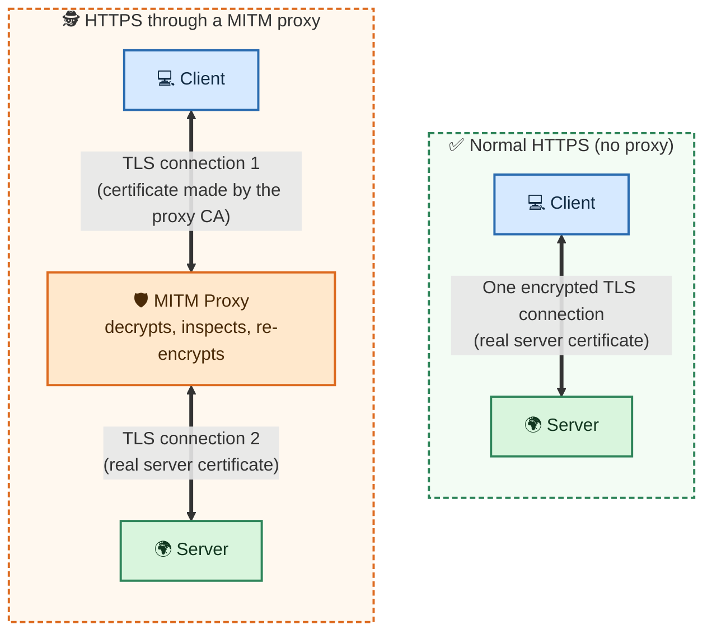
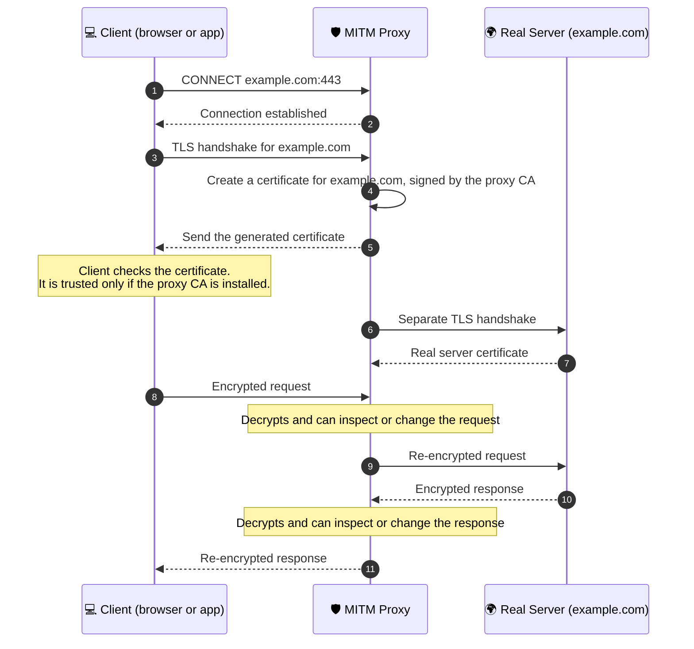
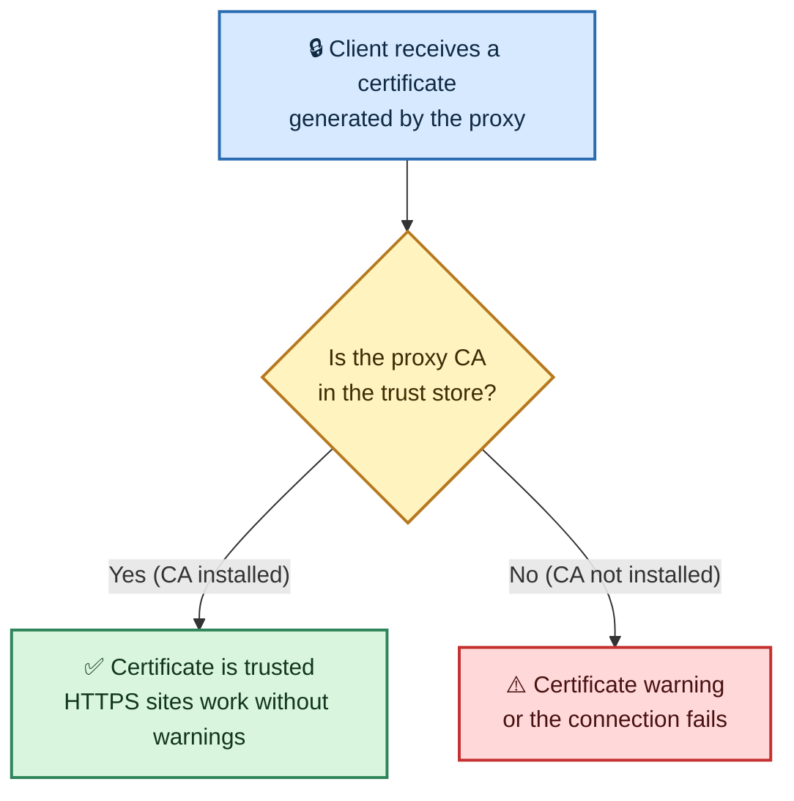
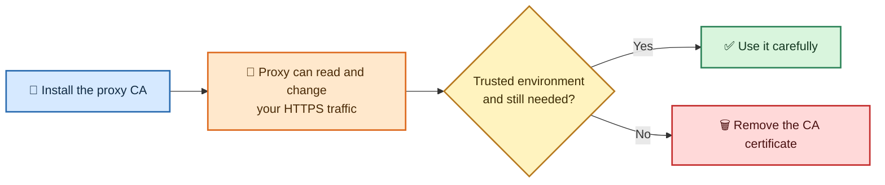

# 🔐 MITM Proxy CA Installation Instructions

## Table of Contents

- [How a MITM Proxy Works](#how-a-mitm-proxy-works)
  - [Normal HTTPS vs HTTPS Through the Proxy](#normal-https-vs-https-through-the-proxy)
  - [Step-by-Step TLS Interception](#step-by-step-tls-interception)
  - [Why You Need to Install the CA Certificate](#why-you-need-to-install-the-ca-certificate)
- [Installing the CA Certificate](#installing-the-ca-certificate)
  - [macOS](#macos)
  - [Windows](#windows)
  - [Linux (Ubuntu/Debian)](#linux-ubuntudebian)
  - [Chrome Browser](#chrome-browser)
- [Verification](#verification)
- [Security Warning](#security-warning)

> The installation steps, verification and security warning are the original instructions. The "How a MITM Proxy Works" section and its diagrams are added explanations, and they come first so the steps below make sense.

---

## How a MITM Proxy Works

MITM stands for **man-in-the-middle**. A MITM proxy sits between your client (browser or app) and the websites you visit. For HTTPS traffic, it **decrypts, inspects and re-encrypts** the data, so you can see and modify requests and responses that would normally be private.

### Normal HTTPS vs HTTPS Through the Proxy

Normally there is **one** encrypted connection, from the client to the real server. With the proxy there are **two**:



### Step-by-Step TLS Interception



### Why You Need to Install the CA Certificate

The proxy creates its own certificates for every site you visit. Your system only trusts certificates signed by a CA (Certificate Authority) in its trust store. The proxy's CA is not in that list by default, so you must add `certs/mitm-ca.crt` yourself.



| Without the CA installed | With the CA installed |
| :--- | :--- |
| ⚠️ The client sees a certificate it does not trust | ✅ The client trusts certificates signed by the proxy CA |
| ⚠️ Browsers show warnings, and apps may fail to connect | ✅ HTTPS sites work through the proxy without warnings |

---

## Installing the CA Certificate

Use the section for your system or browser. Each one adds `certs/mitm-ca.crt` to a trust store.

| System or browser | Where the certificate goes |
| :--- | :--- |
| 🍎 macOS | Keychain Access |
| 🪟 Windows | Trusted Root Certification Authorities |
| 🐧 Linux (Ubuntu/Debian) | `/usr/local/share/ca-certificates/` |
| 🌐 Chrome Browser | Chrome's certificate manager |

### macOS
1. Open Keychain Access
2. Go to File > Import Items
3. Select `certs/mitm-ca.crt`
4. Double-click the imported certificate
5. Expand "Trust" section
6. Set "When using this certificate" to "Always Trust"
7. Close the dialog and enter your password

### Windows
1. Double-click `certs/mitm-ca.crt`
2. Click "Install Certificate..."
3. Choose "Current User" or "Local Machine"
4. Select "Place all certificates in the following store"
5. Click "Browse" and select "Trusted Root Certification Authorities"
6. Click "Next" and "Finish"

### Linux (Ubuntu/Debian)
```bash
sudo cp certs/mitm-ca.crt /usr/local/share/ca-certificates/mitm-proxy-ca.crt
sudo update-ca-certificates
```

### Chrome Browser
1. Open Chrome settings
2. Go to Privacy and security > Security > Manage certificates
3. Click "Import" and select `certs/mitm-ca.crt`
4. Choose "Trust this CA to identify websites"
5. Click "OK"

---

## Verification
After installation, you can verify the CA is trusted by visiting:
- https://mitm.it (should show a certificate warning if CA is not installed)
- Any HTTPS site through the proxy (should work without warnings)

---

## Security Warning
This CA certificate allows the proxy to intercept HTTPS traffic. Only install it in trusted environments and remove it when not needed.

Because the proxy sits in the middle, it can see everything that passes through it in plain text, such as URLs, headers, cookies, passwords and request bodies. Anyone who gets the CA's private key could also create certificates that your system would trust.


