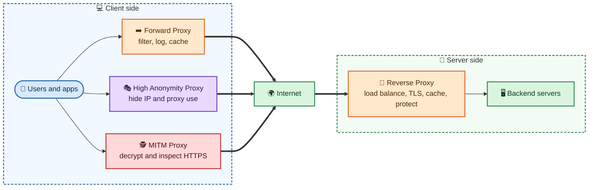
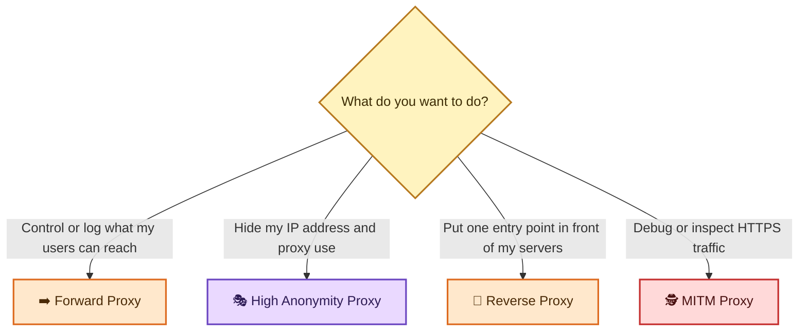

# 🛡️ Proxy

A **proxy** is a server that sits between two parties and passes traffic between them. Depending on where it sits and what it does, it can filter traffic, hide identities, balance load, cache content or even inspect encrypted connections.

This folder explains the main kinds of proxies.

## Table of Contents

- [Proxy Types at a Glance](#proxy-types-at-a-glance)
- [Notes in This Folder](#notes-in-this-folder)
- [How the Proxies Fit Together](#how-the-proxies-fit-together)
- [Comparison](#comparison)
- [Which One Do I Need?](#which-one-do-i-need)
- [Security Notes](#security-notes)

---

## Proxy Types at a Glance

| | Type | In one line |
| :-: | :--- | :--- |
| ➡️ | [**Forward Proxy**](Forward%20Proxy/README.md) | Sits in front of **clients** and makes requests to the internet for them. |
| 🎭 | [**High Anonymity Proxy**](High%20Anonymity%20Proxy/README.md) | A forward proxy that hides your IP **and** the fact that a proxy is used. |
| 🔁 | [**Reverse Proxy**](Reverse%20Proxy/README.md) | Sits in front of **servers** and handles requests from the internet for them. |
| 🕵️ | [**MITM Proxy**](MITM%20Proxy/INSTALL_CA.md) | A proxy that **decrypts and inspects** HTTPS traffic, using a CA certificate you install. |

## Notes in This Folder

| Note | What you will find |
| :--- | :--- |
| ➡️ [Forward Proxy](Forward%20Proxy/README.md) | How it works, HTTP vs HTTPS tunnels, uses, Squid example, cloud and scale |
| 🎭 [High Anonymity Proxy](High%20Anonymity%20Proxy/README.md) | Anonymity levels, what a website sees, what a proxy does not hide, proxy vs VPN vs Tor |
| 🔁 [Reverse Proxy](Reverse%20Proxy/README.md) | How it works, uses, NGINX example, cloud and scale |
| 🕵️ [MITM Proxy](MITM%20Proxy/INSTALL_CA.md) | How TLS interception works, CA installation steps and security warning |

## How the Proxies Fit Together

The first three work on the **client side** and the reverse proxy works on the **server side**. A request can pass through more than one of them, for example a client using a forward proxy to reach a website that is itself behind a reverse proxy.

## Comparison

| | ➡️ Forward | 🎭 High anonymity | 🔁 Reverse | 🕵️ MITM |
| :--- | :--- | :--- | :--- | :--- |
| **Sits in front of** | Clients | Clients | Servers | Clients |
| **Run by** | Company, school or user | Provider or user | Site owner | The person inspecting traffic |
| **Main goal** | Filter, control, cache | Hide identity | Balance, protect, speed up | Inspect and modify HTTPS |
| **Hides client IP** | Yes (from sites) | Yes, and hides proxy use | Not its purpose | Not its purpose |
| **Hides servers** | No | No | Yes | No |
| **Sees HTTPS content** | No (tunnel only) | No (tunnel only) | Yes (it ends TLS for the site) | Yes (it decrypts) |
| **Needs a CA installed on the client** | No | No | No | **Yes** |
| **Typical tools** | Squid, Tinyproxy | Rotating or private proxies | NGINX, HAProxy, cloud load balancers | mitmproxy, Charles, Fiddler |

## Which One Do I Need?

## Security Notes

- 👀 A proxy can see the traffic that passes through it. Only use proxies you trust or run yourself.
- 🔓 A proxy does not encrypt your traffic by default. Use HTTPS.
- 🕵️ Only install a MITM proxy's CA certificate in trusted environments, and remove it when you no longer need it.
- ⚖️ Use proxies lawfully and follow the terms of the websites and services you access.
