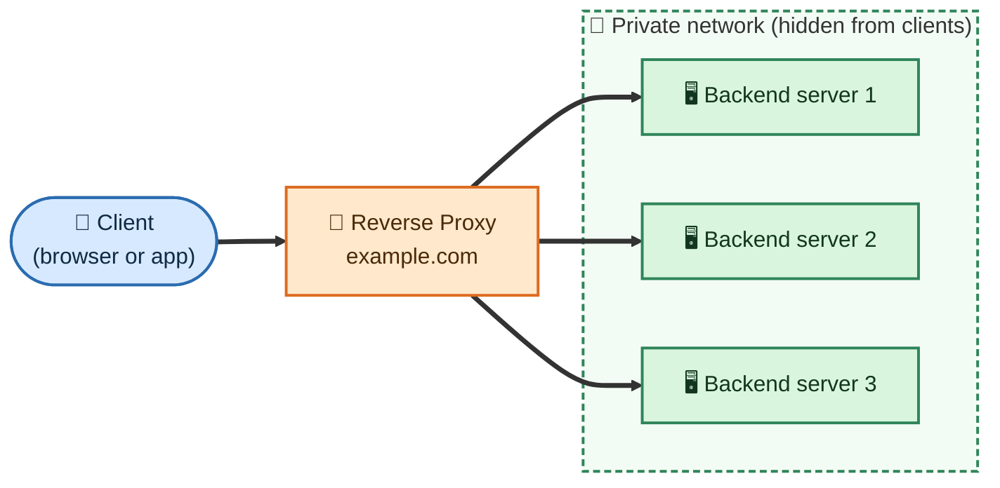
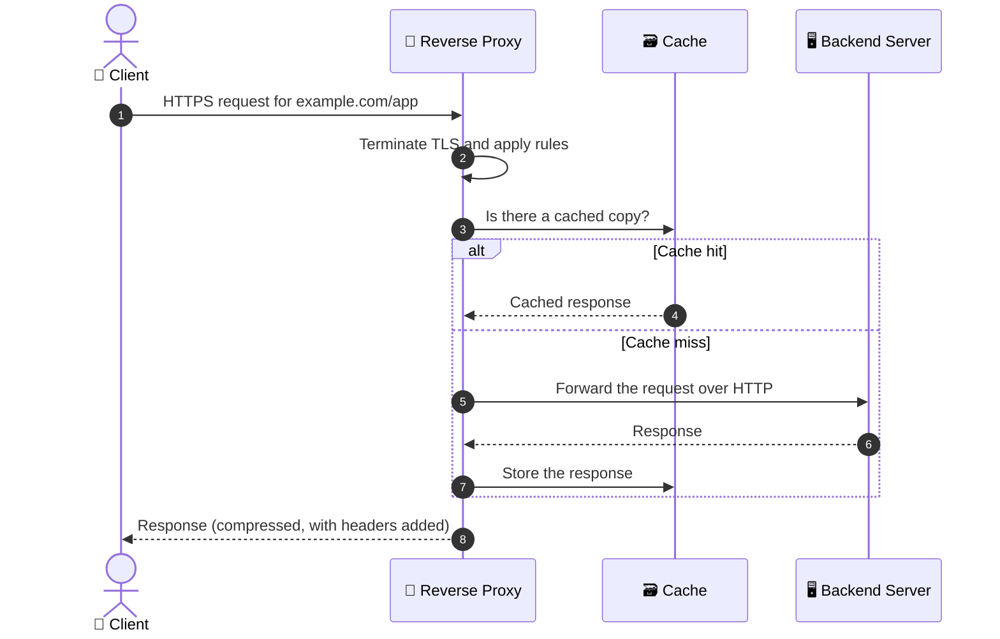
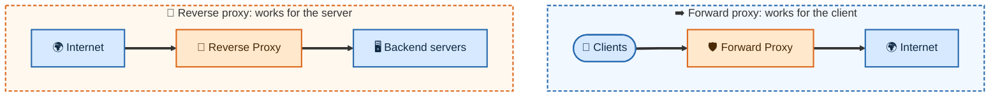
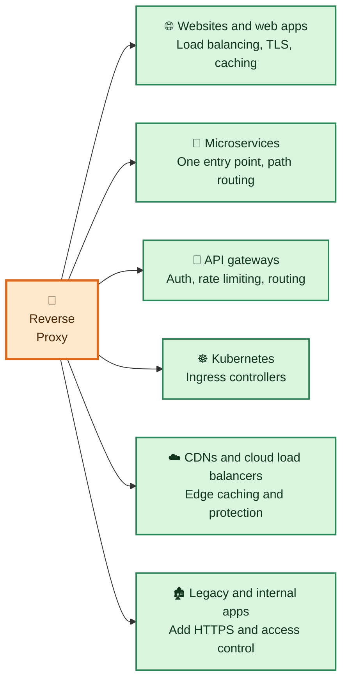
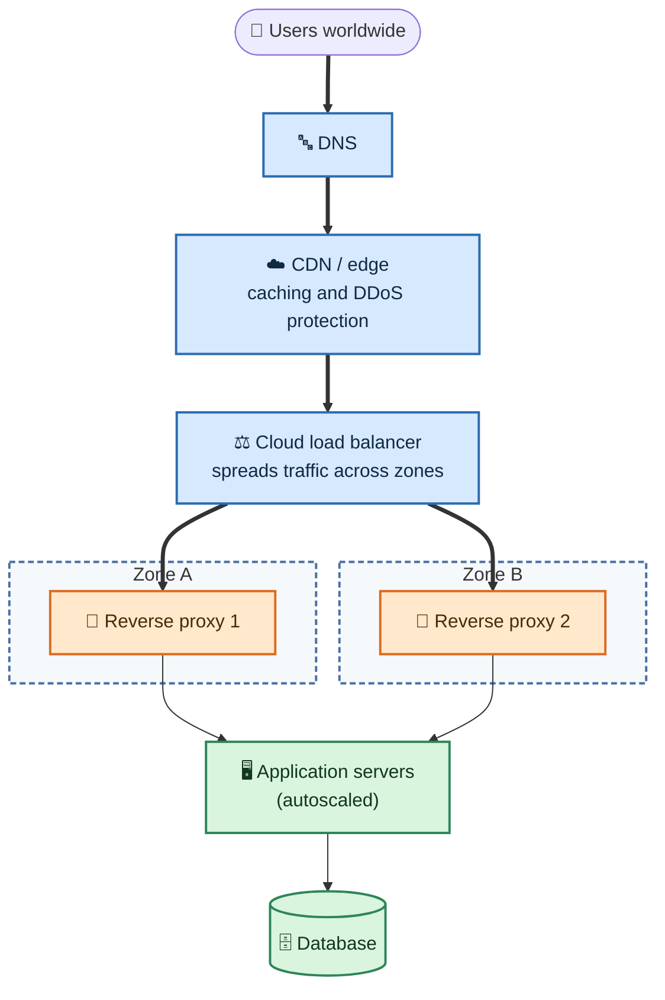

# 🔁 Reverse Proxy

A **reverse proxy** is a server that sits in front of one or more backend servers. Clients talk only to the reverse proxy, and the proxy forwards each request to the right backend and returns the response. The client never connects to the backend directly and usually doesn't know it exists.

## Table of Contents

- [How a Reverse Proxy Works](#how-a-reverse-proxy-works)
- [Forward Proxy vs Reverse Proxy](#forward-proxy-vs-reverse-proxy)
- [What a Reverse Proxy Does](#what-a-reverse-proxy-does)
- [Where Reverse Proxies Are Used](#where-reverse-proxies-are-used)
- [Popular Reverse Proxies](#popular-reverse-proxies)
- [Example: NGINX as a Reverse Proxy](#example-nginx-as-a-reverse-proxy)
- [Reverse Proxy in the Cloud and at Scale](#reverse-proxy-in-the-cloud-and-at-scale)
- [Related Notes](#related-notes)

---

## How a Reverse Proxy Works



Step by step:

1. 🌍 The client sends a request to a public address, for example `https://example.com/app`.
2. 🔁 The reverse proxy receives it. It can end the TLS (HTTPS) connection, check the request, and look in its cache.
3. 🧭 It picks a backend using its rules, such as the host name, the URL path, or a load-balancing algorithm.
4. ➡️ It forwards the request to that backend over the private network.
5. ⬅️ The backend responds to the proxy.
6. 📤 The proxy returns the response to the client, and may cache it, compress it or add headers on the way.



## Forward Proxy vs Reverse Proxy

The two are often confused. The difference is **who the proxy works for**.



| | ➡️ Forward proxy | 🔁 Reverse proxy |
| :--- | :--- | :--- |
| **Sits in front of** | Clients | Servers |
| **Hides** | The clients from the internet | The servers from clients |
| **Set up by** | The client side (user or company network) | The server side (site owner) |
| **Typical uses** | Content filtering, anonymity, access control for users | Load balancing, TLS termination, caching, protection |
| **Client knows about it?** | Yes, it must be configured | Usually not |

> A MITM proxy (see [MITM Proxy](../MITM%20Proxy/INSTALL_CA.md)) is a client-side proxy that also decrypts HTTPS traffic. A reverse proxy is on the server side and is run by the site owner, so clients don't need to install any certificate.

## What a Reverse Proxy Does

| | Function | What it means |
| :-: | :--- | :--- |
| ⚖️ | **Load balancing** | Spreads requests across several backend servers so no single server is overloaded. |
| 🔒 | **TLS termination** | Handles HTTPS in one place, so backends can use plain HTTP and certificates are managed centrally. |
| 🗃️ | **Caching** | Stores responses (such as images and static files) and serves them without asking the backend again. |
| 📦 | **Compression** | Compresses responses (for example with gzip) to save bandwidth. |
| 🛡️ | **Security** | Hides the backend servers and IPs, blocks bad requests, limits request rates and can add a web application firewall (WAF). |
| 🧭 | **Routing** | Sends `/app` to one service and `/api` to another, or sends different host names to different backends. |
| ❤️ | **Health checks and failover** | Stops sending traffic to a backend that is down and uses the healthy ones. |
| 🔗 | **One entry point** | Many services share a single public address and domain. |

## Where Reverse Proxies Are Used



- 🌐 **Websites and web apps:** Put NGINX, HAProxy or similar in front of the application servers to handle HTTPS, caching and load balancing.
- 🧩 **Microservices:** One public domain, with the proxy sending each path or host name to the right service.
- 🚪 **API gateways:** Many API gateways are reverse proxies with extra features such as authentication and rate limiting.
- ☸️ **Kubernetes:** An Ingress controller is a reverse proxy that routes outside traffic to Services. See [ingress vs nginx](../../Infrastructure/ingress%20vs%20nginx.md).
- ☁️ **CDNs and cloud load balancers:** Services like Amazon CloudFront, Cloudflare and cloud application load balancers work as reverse proxies at the edge of the network.
- 🏚️ **Legacy and internal apps:** Add TLS, authentication or access rules in front of an app you can't or don't want to change.

## Popular Reverse Proxies

| Type | Examples |
| :--- | :--- |
| 🧰 **Software you run yourself** | NGINX, HAProxy, Envoy, Traefik, Caddy, Apache HTTP Server |
| ☁️ **Managed cloud services** | AWS Application Load Balancer and CloudFront, Google Cloud Application Load Balancer, Azure Application Gateway and Front Door, Cloudflare |
| ☸️ **Kubernetes ingress controllers** | NGINX Ingress Controller, Traefik, HAProxy Ingress, Envoy-based gateways |

## Example: NGINX as a Reverse Proxy

This configuration receives HTTPS requests for `example.com` and balances them across two backend servers:

```nginx
upstream app_servers {
    server 10.0.0.11:8080;
    server 10.0.0.12:8080;
}

server {
    listen 443 ssl;
    server_name example.com;

    ssl_certificate     /etc/nginx/certs/example.com.crt;
    ssl_certificate_key /etc/nginx/certs/example.com.key;

    location / {
        proxy_pass http://app_servers;

        # Pass the original client details to the backend
        proxy_set_header Host              $host;
        proxy_set_header X-Real-IP         $remote_addr;
        proxy_set_header X-Forwarded-For   $proxy_add_x_forwarded_for;
        proxy_set_header X-Forwarded-Proto $scheme;
    }
}
```

| Setting | Purpose |
| :--- | :--- |
| `upstream` | The group of backend servers. NGINX balances requests across them (round robin by default). |
| `proxy_pass` | Forwards the request to the upstream group. |
| `ssl_certificate` and `ssl_certificate_key` | TLS is terminated at the proxy. |
| `X-Forwarded-For` and `X-Real-IP` | Keep the real client IP, which the backend would otherwise see as the proxy's IP. |
| `X-Forwarded-Proto` | Tells the backend that the client used HTTPS. |

## Reverse Proxy in the Cloud and at Scale



Tips for a reliable and scalable setup:

- ⚙️ **Run at least two proxy instances** so one failure doesn't take the site down.
- 🌍 **Spread them across zones** and put a cloud load balancer in front.
- 📈 **Autoscale** the proxies and the backends based on load.
- ❤️ **Use health checks** so traffic goes only to healthy backends.
- 🗃️ **Cache static content** at the edge (CDN) and at the proxy to reduce backend load.
- 🔒 **Keep TLS certificates in one place** and renew them automatically.
- 🔍 **Log and monitor** the proxy. It sees all traffic, so it is the best place to measure latency and errors.

## Related Notes

- 🗂️ [Proxy overview](../README.md)
- ➡️ [Forward Proxy](../Forward%20Proxy/README.md): the client-side counterpart.
- 🎭 [High Anonymity Proxy](../High%20Anonymity%20Proxy/README.md): a forward proxy that hides your identity.
- ☸️ [Ingress vs NGINX](../../Infrastructure/ingress%20vs%20nginx.md): how a reverse proxy is used as a Kubernetes Ingress controller.
- 🕵️ [MITM Proxy](../MITM%20Proxy/INSTALL_CA.md): a client-side proxy that decrypts HTTPS traffic.
