# SQL Execution Order (Logical Processing Order)

| # | Clause | Description |
| :-: | :--- | :--- |
| 1 | **FROM** | Identifies the tables involved in the query. |
| 2 | **JOIN** | Combines data from multiple tables if specified. |
| 3 | **WHERE** | Filters rows before aggregation. |
| 4 | **GROUP BY** | Groups data into subsets. |
| 5 | **HAVING** | Filters aggregated data. |
| 6 | **SELECT** | Determines which columns or expressions are returned. |
| 7 | **DISTINCT** | Removes duplicate records. |
| 8 | **ORDER BY** | Sorts the results. |
| 9 | **LIMIT/OFFSET** | Restricts the number of rows returned. |

## Diagram

```mermaid
%%{init: {"flowchart": {"nodeSpacing": 40, "rankSpacing": 55, "padding": 16, "htmlLabels": true}}}%%
flowchart TB
    START(["▶️ Your SQL query"])

    subgraph P1["📚 GET THE DATA<br/>"]
        direction TB
        A["<b>1️⃣ FROM</b><br/>Identifies the tables"]
        B["<b>2️⃣ JOIN</b><br/>Combines data from multiple tables"]
    end

    subgraph P2["🔍 FILTER AND GROUP<br/>"]
        direction TB
        C["<b>3️⃣ WHERE</b><br/>Filters rows before aggregation"]
        D["<b>4️⃣ GROUP BY</b><br/>Groups data into subsets"]
        E["<b>5️⃣ HAVING</b><br/>Filters aggregated data"]
    end

    subgraph P3["🎯 CHOOSE THE OUTPUT<br/>"]
        direction TB
        F["<b>6️⃣ SELECT</b><br/>Chooses columns or expressions"]
        G["<b>7️⃣ DISTINCT</b><br/>Removes duplicate records"]
    end

    subgraph P4["📤 SHAPE THE RESULT<br/>"]
        direction TB
        H["<b>8️⃣ ORDER BY</b><br/>Sorts the results"]
        I["<b>9️⃣ LIMIT/OFFSET</b><br/>Restricts the number of rows"]
    end

    DONE(["✅ Result returned"])

    A ==> B
    C ==> D ==> E
    F ==> G
    H ==> I

    START ==> P1 ==> P2 ==> P3 ==> P4 ==> DONE

    classDef s1 fill:#d6e9ff,stroke:#2b6cb0,stroke-width:3px,color:#102a43;
    classDef s2 fill:#fff3bf,stroke:#b7791f,stroke-width:3px,color:#3d2c05;
    classDef s3 fill:#d9f5dd,stroke:#2f855a,stroke-width:3px,color:#12361f;
    classDef s4 fill:#ead9ff,stroke:#6b46c1,stroke-width:3px,color:#2d1b55;
    classDef ends fill:#1a202c,stroke:#1a202c,color:#ffffff;

    class A,B s1;
    class C,D,E s2;
    class F,G s3;
    class H,I s4;
    class START,DONE ends;

    style P1 fill:#f2f8ff,stroke:#2b6cb0,stroke-width:2px,stroke-dasharray: 5 3
    style P2 fill:#fffbea,stroke:#b7791f,stroke-width:2px,stroke-dasharray: 5 3
    style P3 fill:#f3fcf4,stroke:#2f855a,stroke-width:2px,stroke-dasharray: 5 3
    style P4 fill:#f8f3ff,stroke:#6b46c1,stroke-width:2px,stroke-dasharray: 5 3
```

> The four phases (Get the data, Filter and group, Choose the output, Shape the result) are added to make the order easier to remember. They are not in the original image.
