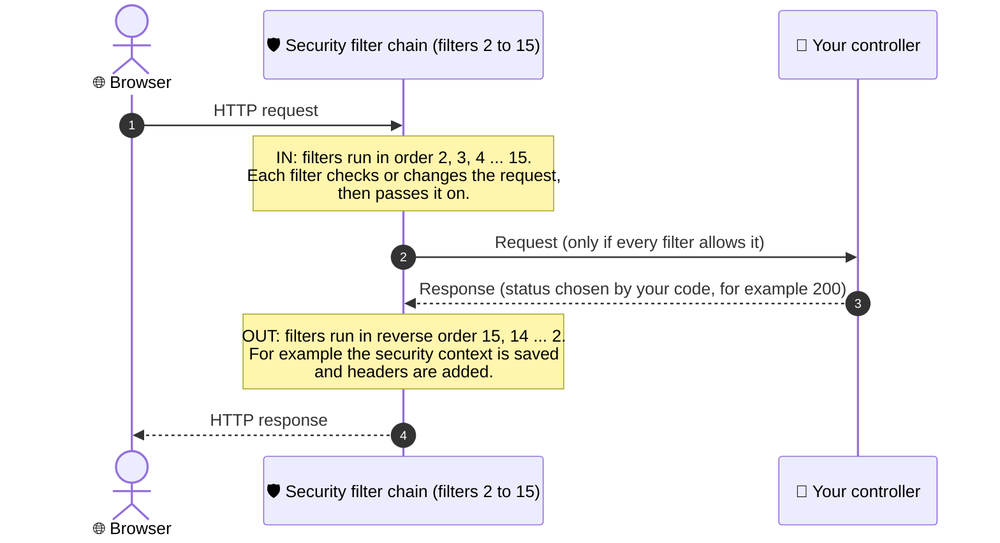
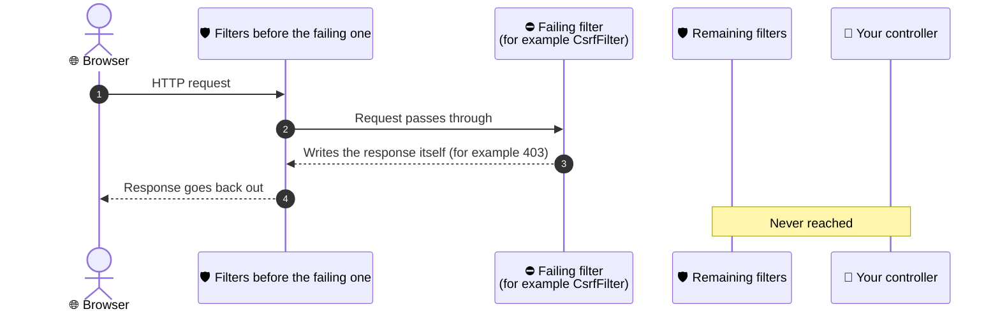
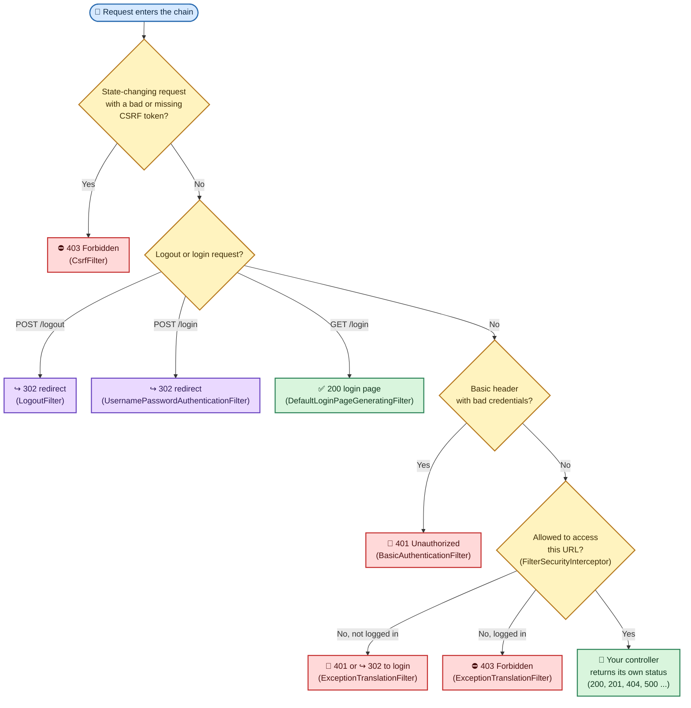
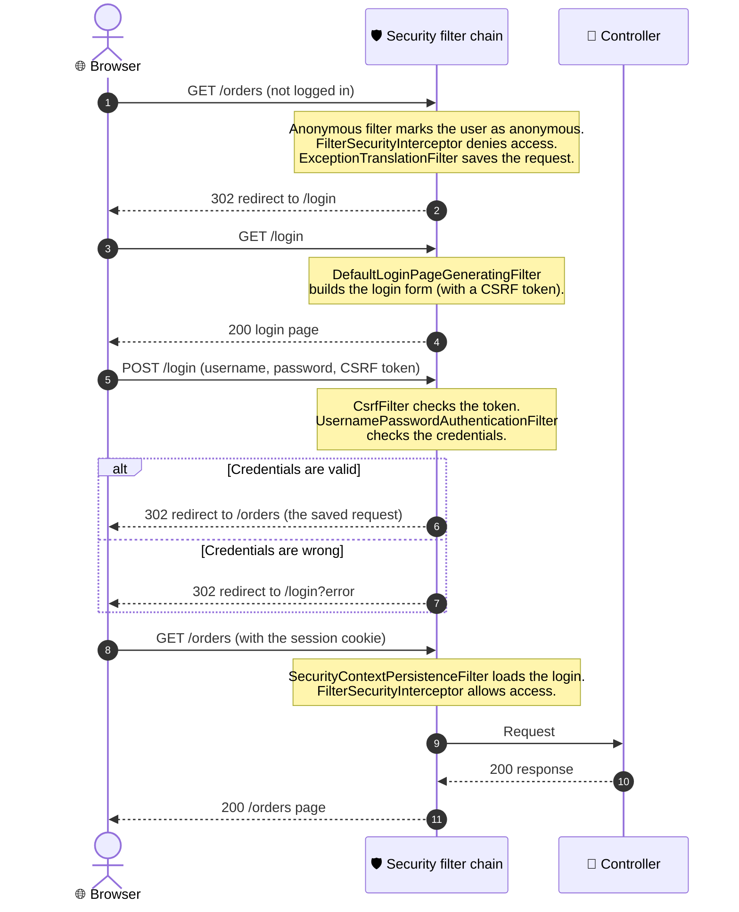

# 🛡️ Spring Filter Chain

The order in which a browser HTTP request passes through the Spring Security filters before it reaches your controller. In the original diagram, the arrows run left to right and continue on the next row.

## Table of Contents

- [Order of the Filters](#order-of-the-filters)
- [Filter Chain Diagram](#filter-chain-diagram)
- [How the Request Goes In and the Response Comes Back](#how-the-request-goes-in-and-the-response-comes-back)
- [What Each Filter Does](#what-each-filter-does)
- [Which Status Codes Can the Chain Return?](#which-status-codes-can-the-chain-return)
- [Where Each Status Is Decided](#where-each-status-is-decided)
- [Example: Form Login From Start to Finish](#example-form-login-from-start-to-finish)
- [Notes](#notes)

> The filter names and their order come from the original diagram. The explanations, status codes and flow diagrams are added.

---

## Order of the Filters

| # | Step |
| :-: | :--- |
| 1 | Browser HTTP Request |
| 2 | `SecurityContextPersistenceFilter` |
| 3 | `HeaderWriterFilter` |
| 4 | `CsrfFilter` |
| 5 | `LogoutFilter` |
| 6 | `UsernamePasswordAuthenticationFilter` |
| 7 | `DefaultLoginPageGeneratingFilter` |
| 8 | `DefaultLogoutPageGeneratingFilter` |
| 9 | `BasicAuthenticationFilter` |
| 10 | `RequestCacheAwareFilter` |
| 11 | `SecurityContextHolderAwareRequestFilter` |
| 12 | `AnonymousAuthenticationFilter` |
| 13 | `SessionManagementFilter` |
| 14 | `ExceptionTranslationFilter` |
| 15 | `FilterSecurityInterceptor` |
| 16 | your `@RestController` / `@Controller` |

## Filter Chain Diagram

The filters are grouped by purpose to make the chain easier to read. The grouping is added, and the order is unchanged.

```mermaid
%%{init: {"flowchart": {"nodeSpacing": 40, "rankSpacing": 55, "padding": 16, "htmlLabels": true}}}%%
flowchart TB
    S0(["🌐 Browser HTTP Request"])

    subgraph G1["🧰 PREPARE THE REQUEST<br/>"]
        direction TB
        S1["2. SecurityContextPersistenceFilter"]
        S2["3. HeaderWriterFilter"]
        S3["4. CsrfFilter"]
    end

    subgraph G2["🔑 LOGOUT AND AUTHENTICATION<br/>"]
        direction TB
        S4["5. LogoutFilter"]
        S5["6. UsernamePasswordAuthenticationFilter"]
        S6["7. DefaultLoginPageGeneratingFilter"]
        S7["8. DefaultLogoutPageGeneratingFilter"]
        S8["9. BasicAuthenticationFilter"]
    end

    subgraph G3["🧩 REQUEST HELPERS<br/>"]
        direction TB
        S9["10. RequestCacheAwareFilter"]
        S10["11. SecurityContextHolderAwareRequestFilter"]
        S11["12. AnonymousAuthenticationFilter"]
        S12["13. SessionManagementFilter"]
    end

    subgraph G4["🚦 ERRORS AND AUTHORIZATION<br/>"]
        direction TB
        S13["14. ExceptionTranslationFilter"]
        S14["15. FilterSecurityInterceptor"]
    end

    S15(["🎯 16. your @RestController / @Controller"])

    S1 --> S2 --> S3
    S4 --> S5 --> S6 --> S7 --> S8
    S9 --> S10 --> S11 --> S12
    S13 --> S14

    S0 ==> G1 ==> G2 ==> G3 ==> G4 ==> S15

    classDef req fill:#d6e9ff,stroke:#2b6cb0,stroke-width:3px,color:#102a43;
    classDef a fill:#d6e9ff,stroke:#2b6cb0,stroke-width:2px,color:#102a43;
    classDef b fill:#fff3bf,stroke:#b7791f,stroke-width:2px,color:#3d2c05;
    classDef c fill:#ead9ff,stroke:#6b46c1,stroke-width:2px,color:#2d1b55;
    classDef d fill:#ffe8cc,stroke:#dd6b20,stroke-width:2px,color:#4a2a07;
    classDef app fill:#d9f5dd,stroke:#2f855a,stroke-width:3px,color:#12361f;

    class S0 req;
    class S1,S2,S3 a;
    class S4,S5,S6,S7,S8 b;
    class S9,S10,S11,S12 c;
    class S13,S14 d;
    class S15 app;

    style G1 fill:#f2f8ff,stroke:#2b6cb0,stroke-width:2px,stroke-dasharray: 5 3
    style G2 fill:#fffbea,stroke:#b7791f,stroke-width:2px,stroke-dasharray: 5 3
    style G3 fill:#f8f3ff,stroke:#6b46c1,stroke-width:2px,stroke-dasharray: 5 3
    style G4 fill:#fff8ef,stroke:#dd6b20,stroke-width:2px,stroke-dasharray: 5 3
```

---

## How the Request Goes In and the Response Comes Back

The filters work like a set of nested layers. Each filter does some work, calls the next filter, and then gets a chance to do more work **after** the rest of the chain has finished.

- ⬇️ **Request path (in):** The request passes through the filters in the order above, from `SecurityContextPersistenceFilter` to `FilterSecurityInterceptor`, and then reaches your controller.
- ⬆️ **Response path (out):** The response comes back through the same filters in **reverse order**, from `FilterSecurityInterceptor` back to `SecurityContextPersistenceFilter`, and then goes to the browser.
- ✋ **Short-circuit:** Any filter can stop the chain and write the response itself, for example `403` or a redirect. The controller is then never called, and the response goes back out through the earlier filters.

If a filter stops the request early, the controller is skipped:

## What Each Filter Does

| # | Filter | What it does | Status it can cause |
| :-: | :--- | :--- | :--- |
| 2 | `SecurityContextPersistenceFilter` | **In:** loads the saved login (the `SecurityContext`) from the session. **Out:** saves it back and clears it from the thread. | None |
| 3 | `HeaderWriterFilter` | Adds security headers to the response, such as `X-Content-Type-Options`, `X-Frame-Options` and `Cache-Control`. | None |
| 4 | `CsrfFilter` | Checks the CSRF token on state-changing requests (`POST`, `PUT`, `PATCH`, `DELETE`). | **403** if the token is missing or wrong |
| 5 | `LogoutFilter` | Handles the logout request (by default `POST /logout`): clears the login and invalidates the session. | **302** redirect (by default to `/login?logout`) |
| 6 | `UsernamePasswordAuthenticationFilter` | Handles the form-login request (`POST /login`) and checks the username and password. | **302** redirect: to the original page on success, to `/login?error` on failure |
| 7 | `DefaultLoginPageGeneratingFilter` | Generates the default login page when you have not made your own. | **200** with an HTML login form (`GET /login`) |
| 8 | `DefaultLogoutPageGeneratingFilter` | Generates the default logout confirmation page. | **200** with an HTML page (`GET /logout`) |
| 9 | `BasicAuthenticationFilter` | Reads an `Authorization: Basic ...` header and authenticates the user. | **401** with `WWW-Authenticate` if the credentials are wrong. No header means it just passes the request on. |
| 10 | `RequestCacheAwareFilter` | After login, replays the request the user originally made, so they land on the page they asked for. | None |
| 11 | `SecurityContextHolderAwareRequestFilter` | Wraps the request so servlet methods like `isUserInRole()` and `getRemoteUser()` work. | None |
| 12 | `AnonymousAuthenticationFilter` | If nobody is logged in, marks the request as "anonymous" so later filters always find an authentication object. | None |
| 13 | `SessionManagementFilter` | Session fixation protection and limits on concurrent sessions. | May reject or redirect requests that break the session rules |
| 14 | `ExceptionTranslationFilter` | Wraps the rest of the chain and turns security exceptions into HTTP responses. | **401** or **302** (not logged in), **403** (logged in but not allowed) |
| 15 | `FilterSecurityInterceptor` | Makes the final **authorization** decision: is this user allowed to access this URL? | Throws an access-denied error, which filter 14 turns into **401**, **302** or **403** |
| 16 | your `@RestController` / `@Controller` | Runs your code. | Whatever your code returns, such as **200**, **201**, **204**, **404** or **500** |

## Which Status Codes Can the Chain Return?

| Status | Meaning here | Produced by |
| :-: | :--- | :--- |
| ✅ **200** | A page was returned | The controller, or the default login or logout page filters |
| ↪️ **302** | Redirect, for example to the login page or back to the original page | `ExceptionTranslationFilter`, `UsernamePasswordAuthenticationFilter`, `LogoutFilter` |
| 🔑 **401** | Not authenticated (no login, or bad credentials) | `BasicAuthenticationFilter`, `ExceptionTranslationFilter` |
| ⛔ **403** | Logged in but not allowed, or the CSRF check failed | `ExceptionTranslationFilter` (after `FilterSecurityInterceptor` denies access), `CsrfFilter` |
| 🔥 **5xx** | An error in your code | The controller |

> Whether a missing login gives **401** or **302** depends on your configuration. With form login, the user is redirected (**302**) to the login page. With HTTP Basic or a token for a REST API, the response is **401**.

## Where Each Status Is Decided

## Example: Form Login From Start to Finish

An anonymous user opens a protected page, logs in, and is sent back to the page they asked for.

## Notes

- 🔧 **Which filters are in the chain depends on your configuration.** For example, `BasicAuthenticationFilter` exists only if HTTP Basic is enabled, and the default login and logout page filters exist only if form login or logout uses the default pages. The diagram shows the chain with these features turned on.
- 🆕 **Newer Spring Security versions changed some filters.** In Spring Security 6, `SecurityContextPersistenceFilter` is replaced by `SecurityContextHolderFilter`, and `FilterSecurityInterceptor` is replaced by `AuthorizationFilter`. The overall idea and order stay the same.
- 🔍 **See your real chain:** Turn on debug logging for `org.springframework.security` (or use `@EnableWebSecurity(debug = true)`). The log lists the filters that run for each request.
