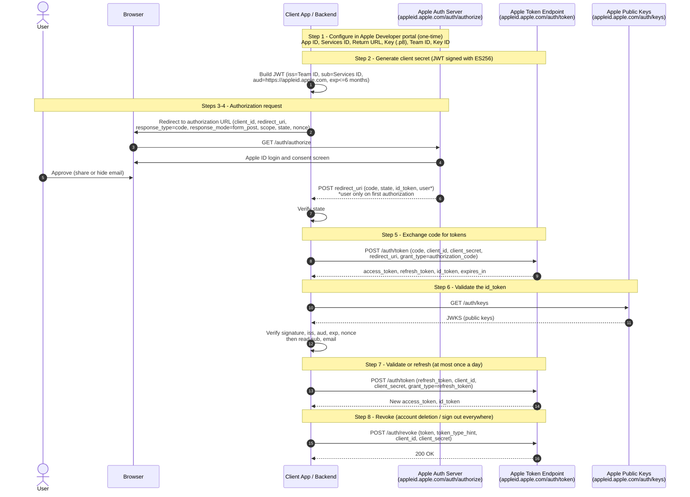

# Sign in with Apple (OAuth 2.0 / OpenID Connect) Flow with cURL

This guide walks through the **authorization code flow** for *Sign in with Apple* on the web, using a browser, a small script to generate the client secret, and cURL.

Apple's implementation is OAuth 2.0 + OpenID Connect, but it differs from Google's in several ways:

| Topic | Google | Apple |
|---|---|---|
| Client secret | Static string from the Console | **JWT you generate**, signed (ES256) with a private `.p8` key. Expires in at most 6 months |
| Client ID | OAuth client ID | **Services ID** (web) or **Bundle ID** (native apps) |
| Scopes | Many API scopes | Only `name` and `email` |
| Redirect | `GET` with `?code=` | `POST` (`form_post`) when `name`/`email` scopes are requested |
| Redirect URI | `http://localhost` allowed | **HTTPS and a real domain required.** `localhost` and IP addresses are not allowed |
| User info | `userinfo` endpoint | **No userinfo endpoint.** Identity is in the `id_token` (JWT) |
| User name | Always available | Returned **only the first time** the user authorizes |
| Refresh token | Needs `access_type=offline` | Always returned with the code exchange |
| Authorization code lifetime | A few minutes | 5 minutes, single use |

## Overview



## Placeholders

| Placeholder | Description | Where to get it |
|---|---|---|
| `[CLIENT_ID]` | **Services ID** identifier, e.g. `com.example.web` (use the Bundle ID for native apps) | Apple Developer > Certificates, Identifiers & Profiles > Identifiers |
| `[TEAM_ID]` | 10-character Apple Developer Team ID | Apple Developer > Membership details |
| `[KEY_ID]` | 10-character ID of the Sign in with Apple private key | Apple Developer > Keys |
| `[PRIVATE_KEY]` | The `AuthKey_[KEY_ID].p8` file (downloadable **only once**) | Apple Developer > Keys |
| `[CLIENT_SECRET]` | JWT generated from the values above | Step 2 |
| `[REDIRECT_URI]` | HTTPS URL on your domain, e.g. `https://example.com/auth/apple/callback` | Must be registered as a *Return URL* on the Services ID |
| `[STATE]` | Random string to prevent CSRF | Generate per request |
| `[NONCE]` | Random string to prevent replay attacks (echoed in `id_token`) | Generate per request |
| `[AUTH_CODE]` | One-time code (valid 5 minutes) | Step 4 |
| `[ACCESS_TOKEN]` | Short-lived token (about 1 hour) | Step 5 |
| `[REFRESH_TOKEN]` | Long-lived token that does not expire unless revoked | Step 5 |

> **Note:** Never commit the `.p8` key, `[CLIENT_SECRET]` or tokens to source control. Generate the client secret on your backend, never in a browser or mobile app.

> **Testing locally:** Apple rejects `localhost` Return URLs. Use a public HTTPS tunnel (e.g. ngrok or Cloudflare Tunnel) on a domain you register with Apple.

---

## Step 1: Configure Sign in with Apple

Requires a paid Apple Developer Program membership.

1. Sign in to [Apple Developer](https://developer.apple.com/account/) > **Certificates, Identifiers & Profiles**.
2. **App ID:** under *Identifiers*, create or open an App ID and enable the **Sign in with Apple** capability.
3. **Services ID** (this is your `[CLIENT_ID]` for web):
   1. Create a new identifier of type *Services IDs*.
   2. Enable **Sign in with Apple** and click **Configure**.
   3. Select the primary App ID.
   4. Add your **Domain** (for example `example.com`) and **Return URL** (`[REDIRECT_URI]`).
   5. Save.
4. **Key:** under *Keys*, create a key with **Sign in with Apple** enabled, linked to the primary App ID.
5. Download the `.p8` file (one-time only) and note the **Key ID**.
6. Note your **Team ID** (top right of the portal or under *Membership details*).

## Step 2: Generate the client secret (JWT)

Apple requires the client secret to be a JWT signed with your private key using **ES256**.

**Header**

```json
{ "alg": "ES256", "kid": "[KEY_ID]" }
```

**Payload**

```json
{
  "iss": "[TEAM_ID]",
  "iat": 1700000000,
  "exp": 1715000000,
  "aud": "https://appleid.apple.com",
  "sub": "[CLIENT_ID]"
}
```

`exp` must be no more than **15,777,000 seconds (6 months)** after `iat`.

Example with Python (`pip install pyjwt cryptography`):

```python
import time
import jwt  # PyJWT

TEAM_ID = "[TEAM_ID]"
CLIENT_ID = "[CLIENT_ID]"
KEY_ID = "[KEY_ID]"
PRIVATE_KEY = open("AuthKey_[KEY_ID].p8").read()

now = int(time.time())
client_secret = jwt.encode(
    {
        "iss": TEAM_ID,
        "iat": now,
        "exp": now + 86400 * 180,  # 180 days, under the 6-month limit
        "aud": "https://appleid.apple.com",
        "sub": CLIENT_ID,
    },
    PRIVATE_KEY,
    algorithm="ES256",
    headers={"kid": KEY_ID},
)
print(client_secret)
```

Use the printed value as `[CLIENT_SECRET]`. Regenerate it before it expires.

## Step 3: Build the authorization URL

```
https://appleid.apple.com/auth/authorize
  ?client_id=[CLIENT_ID]
  &redirect_uri=[REDIRECT_URI]
  &response_type=code
  &response_mode=form_post
  &scope=name%20email
  &state=[STATE]
  &nonce=[NONCE]
```

Join the parameters without line breaks or spaces when you use it.

| Parameter | Purpose |
|---|---|
| `response_type=code` | Requests an authorization code (use `code id_token` for a hybrid flow) |
| `response_mode=form_post` | **Required** when requesting `name` or `email`. Apple POSTs the result to your Return URL |
| `scope=name email` | The only scopes Apple supports. Omit both to get just the `sub` identifier |
| `state` | Random value to prevent CSRF; verify it matches on return |
| `nonce` | Random value that Apple embeds in the `id_token`; verify it to prevent replay |

## Step 4: Authorize and capture the code

1. Open the URL in a browser, sign in with an Apple ID, and choose whether to **share** or **hide** your email.
2. Apple sends an HTTP `POST` (not a `GET`) to `[REDIRECT_URI]` with form fields:

   | Field | Description |
   |---|---|
   | `code` | `[AUTH_CODE]`, single use, valid 5 minutes |
   | `state` | Must match the value you sent |
   | `id_token` | JWT containing the user identity |
   | `user` | JSON such as `{"name":{"firstName":"A","lastName":"B"},"email":"a@b.com"}`. **Sent only the first time** the user authorizes your app |

3. Because the response is a POST, you cannot copy the code from the address bar. Your server must receive it. For manual testing, point the Return URL at an endpoint that logs the form body, such as a small server behind a tunnel.
4. Verify `state`.

> **Save the `user` data immediately.** Apple never sends the name again, even on later sign-ins. To receive it again, the user must remove the app under *Apple ID > Sign in with Apple* and authorize again.

## Step 5: Exchange the code for tokens

```bash
curl --request POST \
  --header "Content-Type: application/x-www-form-urlencoded" \
  --data-urlencode "code=[AUTH_CODE]" \
  --data-urlencode "client_id=[CLIENT_ID]" \
  --data-urlencode "client_secret=[CLIENT_SECRET]" \
  --data-urlencode "redirect_uri=[REDIRECT_URI]" \
  --data-urlencode "grant_type=authorization_code" \
  https://appleid.apple.com/auth/token
```

Example response:

```json
{
  "access_token": "a1b2c3...",
  "token_type": "Bearer",
  "expires_in": 3600,
  "refresh_token": "r1a2b3...",
  "id_token": "eyJraWQiOiJ..."
}
```

> Apple's access token isn't used to call a user-info API. Your identity data comes from the `id_token`. The `refresh_token` is what you keep to confirm the user's authorization is still valid.

## Step 6: Validate the `id_token`

Never trust an `id_token` until you verify it.

1. Fetch Apple's public keys (cache them):

   ```bash
   curl https://appleid.apple.com/auth/keys
   ```

2. Pick the key whose `kid` matches the JWT header and verify the **RS256** signature.
3. Check the claims:

   | Claim | Expected value |
   |---|---|
   | `iss` | `https://appleid.apple.com` |
   | `aud` | Your `[CLIENT_ID]` |
   | `exp` | In the future |
   | `nonce` | Equals the `[NONCE]` you sent |

4. Read the user data from the claims:

   ```json
   {
     "iss": "https://appleid.apple.com",
     "aud": "[CLIENT_ID]",
     "exp": 1700003600,
     "iat": 1700000000,
     "sub": "001234.abcdef0123456789.1234",
     "nonce": "[NONCE]",
     "email": "abc123@privaterelay.appleid.com",
     "email_verified": true,
     "is_private_email": true,
     "auth_time": 1700000000
   }
   ```

   - `sub` is the stable, unique user ID for your team. **Use it as the account key**, not the email.
   - `is_private_email: true` means the user chose *Hide My Email*. You must send mail through Apple's private relay (register your sending domain in the Developer portal).

## Step 7: Refresh or validate the token

Apple recommends checking the refresh token **at most once per day**.

```bash
curl --request POST \
  --header "Content-Type: application/x-www-form-urlencoded" \
  --data-urlencode "client_id=[CLIENT_ID]" \
  --data-urlencode "client_secret=[CLIENT_SECRET]" \
  --data-urlencode "refresh_token=[REFRESH_TOKEN]" \
  --data-urlencode "grant_type=refresh_token" \
  https://appleid.apple.com/auth/token
```

The response has a new `access_token` and `id_token`, and no new refresh token. Keep the original. An `invalid_grant` error means the user revoked access, so sign them out of your app.

## Step 8: Revoke a token

Required when a user deletes their account in your app (App Store guideline).

```bash
curl --request POST \
  --header "Content-Type: application/x-www-form-urlencoded" \
  --data-urlencode "client_id=[CLIENT_ID]" \
  --data-urlencode "client_secret=[CLIENT_SECRET]" \
  --data-urlencode "token=[REFRESH_TOKEN]" \
  --data-urlencode "token_type_hint=refresh_token" \
  https://appleid.apple.com/auth/revoke
```

`token_type_hint` is `refresh_token` or `access_token`. A successful call returns `200 OK` with an empty body.

---

## Troubleshooting

| Error | Likely cause |
|---|---|
| `invalid_client` | Bad client secret: wrong `kid`, `iss` (Team ID) or `sub` (Services ID), expired JWT, `exp` over 6 months, or wrong `aud` |
| `invalid_grant` | Code already used or older than 5 minutes, wrong `redirect_uri`, or refresh token revoked |
| `invalid_request` | Missing parameter, or `response_mode` is not `form_post` while requesting `name`/`email` |
| `invalid_scope` | Scope other than `name` or `email` |
| `unsupported_grant_type` | Typo in `grant_type` |
| `Invalid redirect_uri` in browser | Return URL isn't registered on the Services ID, isn't HTTPS, or is `localhost`/an IP address |
| No `name` or `email` in the response | User has already authorized the app before, so Apple only sends them the first time |

## References

- [Sign in with Apple REST API](https://developer.apple.com/documentation/signinwithapplerestapi)
- [Generate and validate tokens](https://developer.apple.com/documentation/signinwithapplerestapi/generate_and_validate_tokens)
- [Creating a client secret](https://developer.apple.com/documentation/accountorganizationaldatasharing/creating-a-client-secret)
- [Revoke tokens](https://developer.apple.com/documentation/signinwithapplerestapi/revoke_tokens)
- [Fetch Apple's public key for verifying token signature](https://developer.apple.com/documentation/signinwithapplerestapi/fetch_apple_s_public_key_for_verifying_token_signature)
- [Sign in with Apple JS](https://developer.apple.com/documentation/signinwithapplejs)
- [OAuth](https://oauth.net/)
- [OAuth References](https://datatracker.ietf.org/doc/draft-ietf-oauth-v2-1/references/)
