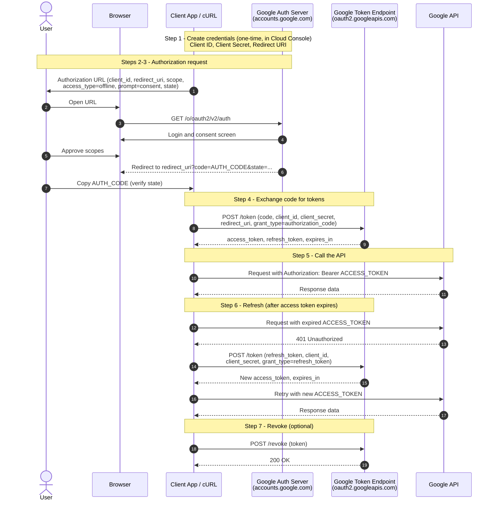

# Google OAuth 2.0 Flow with cURL

This guide walks through the full OAuth 2.0 **authorization code flow** against Google's APIs using only a browser and cURL.

## Overview



## Placeholders

| Placeholder | Description | Where to get it |
|---|---|---|
| `[CLIENT_ID]` | Application client ID | Google Cloud Console > APIs & Services > Credentials |
| `[CLIENT_SECRET]` | Application client secret | Same as above |
| `[REDIRECT_URI]` | URI Google sends the user back to, e.g. `http://localhost:8080` | Must be registered in the OAuth client |
| `[SCOPES]` | Space-separated list of scopes, URL-encoded (space = `%20`) | [Google OAuth scopes](https://developers.google.com/identity/protocols/oauth2/scopes) |
| `[AUTH_CODE]` | One-time code returned after consent | Step 3 |
| `[ACCESS_TOKEN]` | Short-lived token (about 1 hour) for API calls | Step 4 / 6 |
| `[REFRESH_TOKEN]` | Long-lived token used to get new access tokens | Step 4 |

> **Note:** Keep `[CLIENT_SECRET]` and tokens private. Never commit them to source control.

> **Deprecated:** The out-of-band (OOB) redirect `urn:ietf:wg:oauth:2.0:oob` was blocked by Google and no longer works. Use a loopback redirect such as `http://localhost:8080` instead.

---

## Step 1: Create OAuth credentials

1. Open the [Google Cloud Console](https://console.cloud.google.com/) and select or create a project.
2. Enable the API you want to call (APIs & Services > Library).
3. Configure the **OAuth consent screen**.
4. Go to **Credentials > Create Credentials > OAuth client ID**.
5. Add `[REDIRECT_URI]` (e.g. `http://localhost:8080`) under *Authorized redirect URIs*.
6. Copy the **Client ID** and **Client Secret**.

## Step 2: Build the authorization URL

```
https://accounts.google.com/o/oauth2/v2/auth
  ?client_id=[CLIENT_ID]
  &redirect_uri=[REDIRECT_URI]
  &response_type=code
  &scope=[SCOPES]
  &access_type=offline
  &prompt=consent
  &state=[RANDOM_STRING]
```

Join the parameters without line breaks or spaces when you use it.

| Parameter | Purpose |
|---|---|
| `response_type=code` | Requests an authorization code |
| `access_type=offline` | **Required to receive a refresh token** |
| `prompt=consent` | Forces the consent screen so a refresh token is issued again |
| `state` | Random value to prevent CSRF; verify it matches in the redirect |

## Step 3: Authorize and copy the code

1. Paste the URL into a browser and accept the requested scopes.
2. Google redirects to `[REDIRECT_URI]?code=[AUTH_CODE]&state=...`.
3. The page may fail to load if nothing is listening on that port. That is fine: copy the `code` value from the address bar.
4. Confirm `state` matches the value you sent.

> The code is single-use and expires within minutes. URL-decode it if it contains `%2F` (decode to `/`).

## Step 4: Exchange the code for tokens

```bash
curl --request POST \
  --data "code=[AUTH_CODE]" \
  --data "client_id=[CLIENT_ID]" \
  --data "client_secret=[CLIENT_SECRET]" \
  --data "redirect_uri=[REDIRECT_URI]" \
  --data "grant_type=authorization_code" \
  https://oauth2.googleapis.com/token
```

Example response:

```json
{
  "access_token": "ya29.a0...",
  "expires_in": 3599,
  "refresh_token": "1//0g...",
  "scope": "https://www.googleapis.com/auth/...",
  "token_type": "Bearer"
}
```

Save the `refresh_token` securely. Google returns it only on the first consent (or whenever `prompt=consent` is used).

## Step 5: Call a Google API

```bash
curl --header "Authorization: Bearer [ACCESS_TOKEN]" \
  https://www.googleapis.com/oauth2/v3/userinfo
```

(The example needs the `openid profile email` scopes. Swap the URL for the API you enabled.)

## Step 6: Refresh the access token

When the access token expires (a `401` response, or after `expires_in` seconds), exchange the refresh token for a new one:

```bash
curl --request POST \
  --data "client_id=[CLIENT_ID]" \
  --data "client_secret=[CLIENT_SECRET]" \
  --data "refresh_token=[REFRESH_TOKEN]" \
  --data "grant_type=refresh_token" \
  https://oauth2.googleapis.com/token
```

The response contains a new `access_token` and `expires_in`. It usually does not include a new refresh token, so keep using the original one.

## Step 7: Revoke a token (optional)

```bash
curl --request POST \
  --data "token=[ACCESS_TOKEN or REFRESH_TOKEN]" \
  https://oauth2.googleapis.com/revoke
```

Revoking a refresh token also invalidates the access tokens issued from it.

---

## Troubleshooting

| Error | Likely cause |
|---|---|
| `invalid_grant` | Code already used or expired, wrong `redirect_uri`, or refresh token revoked/expired |
| `redirect_uri_mismatch` | `redirect_uri` doesn't exactly match one registered in the Console |
| `invalid_client` | Wrong client ID or secret |
| `invalid_scope` | Scope misspelled or not URL-encoded |
| No `refresh_token` in response | Missing `access_type=offline`, or consent was already granted (add `prompt=consent`) |
| `access_denied` | User declined, or app is in testing mode and the user isn't a listed test user |

## References

- [Using OAuth 2.0 for Web Server Applications](https://developers.google.com/identity/protocols/oauth2/web-server)
- [OAuth 2.0 Scopes for Google APIs](https://developers.google.com/identity/protocols/oauth2/scopes)
- [OAuth out-of-band (OOB) flow migration](https://developers.google.com/identity/protocols/oauth2/resources/oob-migration)
- [OAuth](https://oauth.net/)
- [OAuth References](https://datatracker.ietf.org/doc/draft-ietf-oauth-v2-1/references/)
