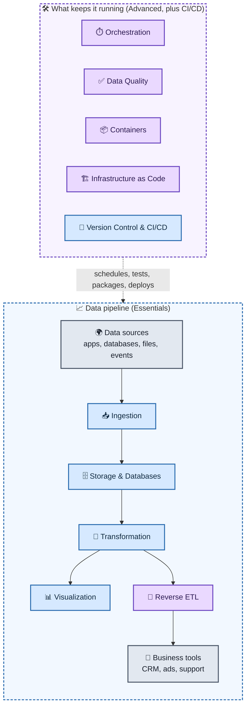

# 🧱 The 10 Modern Data Components

A modern data platform is built from ten building blocks. Five are **essentials** that every data platform needs. Five are **advanced** components that make the platform reliable, repeatable and useful to the business.

## Table of Contents

- [The List](#the-list)
- [How the Components Fit Together](#how-the-components-fit-together)
- [Essentials](#essentials)
  - [1. Storage & Databases](#1-storage--databases)
  - [2. Ingestion](#2-ingestion)
  - [3. Transformation](#3-transformation)
  - [4. Visualization](#4-visualization)
  - [5. Version Control & CI/CD](#5-version-control--cicd)
- [Advanced](#advanced)
  - [1. Orchestration](#1-orchestration)
  - [2. Containers](#2-containers)
  - [3. Infrastructure as Code (IaC)](#3-infrastructure-as-code-iac)
  - [4. Data Quality](#4-data-quality)
  - [5. Reverse ETL](#5-reverse-etl)
- [Example: One Data Flow End to End](#example-one-data-flow-end-to-end)
- [Where to Start](#where-to-start)

> The component names come from the original list. The explanations, benefits, example tools and diagrams are added.

---

## The List

| # | Essentials | Advanced |
| :-: | :--- | :--- |
| 1 | Storage & Databases | Orchestration |
| 2 | Ingestion | Containers |
| 3 | Transformation | Infrastructure as Code (IaC) |
| 4 | Visualization | Data Quality |
| 5 | Version Control & CI/CD | Reverse ETL |

At a glance:

| Component | What it does | Main benefit |
| :--- | :--- | :--- |
| 🗄️ **Storage & Databases** | Holds the data | One reliable place for all data |
| 📥 **Ingestion** | Moves data in from sources | Fresh data without manual work |
| 🔧 **Transformation** | Cleans and models the data | Trusted, analytics-ready data |
| 📊 **Visualization** | Shows the data in dashboards | Insights for everyone |
| 🔀 **Version Control & CI/CD** | Tracks, tests and deploys code | Safe, repeatable changes |
| ⏱️ **Orchestration** | Schedules and coordinates tasks | Reliable, ordered pipelines |
| 📦 **Containers** | Packages code and its dependencies | Runs the same everywhere |
| 🏗️ **Infrastructure as Code** | Defines infrastructure in code | Repeatable environments |
| ✅ **Data Quality** | Tests and monitors the data | Data people can trust |
| 🔁 **Reverse ETL** | Sends data back to business tools | Data used where work happens |

---

## How the Components Fit Together

| Color | Meaning |
| :-: | :--- |
| 🟦 | Essential components |
| 🟪 | Advanced components |
| ⬜ | Outside the platform (sources and business tools) |

---

## Essentials

### 1. Storage & Databases

Where the data lives. This is the foundation that every other component reads from or writes to.

- **How it is used:**
  - **Data warehouses** store structured data for analytics.
  - **Data lakes** keep raw files of any kind.
  - **Lakehouses** combine the two.
  - **Operational databases** run the applications that produce the data.
- **Benefits:**
  - One shared, reliable source of truth.
  - Scales as data grows.
  - Fast queries for analysis.
  - Costs can be lowered by keeping rarely used data in cheaper storage.
- **Example tools:** Snowflake, BigQuery, Amazon Redshift, Amazon S3, Azure Data Lake Storage, Databricks (Delta Lake), PostgreSQL, MySQL.

### 2. Ingestion

Moves data from where it is created (apps, databases, files, APIs, events) into your storage.

- **How it is used:**
  - **Batch** ingestion copies data on a schedule, such as every hour.
  - **Streaming** ingestion sends events continuously as they happen.
  - **Change data capture (CDC)** copies only the rows that changed in a database.
- **Benefits:**
  - Replaces hand-written copy scripts.
  - Keeps data fresh.
  - Connectors handle many sources.
  - Fewer errors and less maintenance.
- **Example tools:** Fivetran, Airbyte, Apache Kafka, Amazon Kinesis, Debezium.

### 3. Transformation

Turns raw data into clean, organized tables that people and tools can use.

- **How it is used:**
  - Clean data (fix types, remove duplicates).
  - Join data from different sources.
  - Calculate business metrics.
  - Many teams load raw data first, then transform it inside the warehouse. This is called **ELT**, and it is usually written in SQL.
- **Benefits:**
  - Trusted, consistent numbers.
  - Reusable data models.
  - Logic is written as code, so it can be tested and reviewed.
  - Analysts can work without engineers.
- **Example tools:** dbt, Apache Spark, SQL in the warehouse.

### 4. Visualization

Turns data into charts, dashboards and reports that people can read.

- **How it is used:**
  - Build dashboards for sales, operations or product use.
  - Let teams explore data themselves ("self-service").
  - Share regular reports.
- **Benefits:**
  - Insights for people who don't write code.
  - Faster, better-informed decisions.
  - Everyone looks at the same numbers.
- **Example tools:** Tableau, Power BI, Looker, Metabase, Apache Superset.

### 5. Version Control & CI/CD

Tracks every change to the code (pipelines, SQL, configuration) and automatically tests and deploys it.

- **How it is used:**
  - Store all code in **Git**.
  - Review changes through **pull requests**.
  - **CI** (continuous integration) runs tests on every change.
  - **CD** (continuous delivery or deployment) releases approved changes automatically.
- **Benefits:**
  - Full history of who changed what and why.
  - Easy rollback.
  - Teams can work together without overwriting each other.
  - Fewer broken releases.
- **Example tools:** Git, GitHub, GitLab, Bitbucket, GitHub Actions, GitLab CI, Jenkins.

---

## Advanced

### 1. Orchestration

Schedules and coordinates the steps of a pipeline, so each runs in the right order.

- **How it is used:**
  - Define a workflow such as "ingest, then transform, then test, then refresh dashboards".
  - Run it on a schedule or when new data arrives.
  - Retry failed steps and send alerts.
- **Benefits:**
  - Pipelines run in the correct order without manual work.
  - Automatic retries and alerts.
  - One place to see what ran, what failed and why.
- **Example tools:** Apache Airflow, Dagster, Prefect, AWS Step Functions.

### 2. Containers

Package code together with everything it needs (libraries, runtime, settings) so it runs the same way anywhere.

- **How it is used:**
  - Build an image with **Docker**.
  - Run the same image on a laptop, a test server and in production.
  - Use **Kubernetes** to run and scale many containers.
- **Benefits:**
  - "Works on my machine" problems go away.
  - Portable across clouds and servers.
  - Easy to scale up and down.
  - Jobs are isolated from each other.
- **Example tools:** Docker, Kubernetes, Amazon ECS, Amazon EKS.

### 3. Infrastructure as Code (IaC)

Defines servers, databases, networks and permissions in code files instead of clicking in a console.

- **How it is used:**
  - Write the infrastructure you want in files kept in Git.
  - Apply them with a tool, which creates or updates the infrastructure to match.
  - Reuse the same files to build dev, test and production environments.
- **Benefits:**
  - Repeatable, consistent environments.
  - Changes are reviewed like any other code.
  - A lost environment can be rebuilt quickly.
  - Less drift between environments, and fewer manual mistakes.
- **Example tools:** Terraform, AWS CloudFormation, Pulumi, Azure Bicep.

### 4. Data Quality

Checks that data is correct, complete and up to date, and alerts people when it isn't.

- **How it is used:**
  - Add tests such as "this column is never empty", "ids are unique" or "the data arrived today".
  - Monitor for sudden changes in volume or values.
  - Stop the pipeline, or alert the team, when a check fails.
- **Benefits:**
  - Problems are caught before they reach dashboards.
  - People trust the data.
  - Less time spent hunting for the cause of wrong numbers.
- **Example tools:** Great Expectations, dbt tests, Soda, Monte Carlo.

### 5. Reverse ETL

Sends cleaned data from the warehouse **back into** the tools that business teams use every day.

- **How it is used:**
  - Sync customer scores or segments to a CRM.
  - Send audiences to advertising platforms.
  - Push product usage data to support or marketing tools.
- **Benefits:**
  - Insights are used where people work, not only in dashboards.
  - The warehouse stays the single source of truth.
  - Replaces manual exports and spreadsheets.
- **Example tools:** Census, Hightouch.

---

## Example: One Data Flow End to End

A company wants to know its best customers and give that list to its sales team.

1. 📥 **Ingestion** copies orders from the shop database into the warehouse every hour.
2. 🗄️ **Storage & Databases** keeps the raw orders in the warehouse.
3. 🔧 **Transformation** builds a clean "customer lifetime value" table.
4. ✅ **Data Quality** checks that order IDs are unique and the data is fresh.
5. 📊 **Visualization** shows revenue and top customers on a dashboard.
6. 🔁 **Reverse ETL** sends the top customers into the sales team's CRM.
7. ⏱️ **Orchestration** runs steps 1 to 6 in the right order every hour and retries failures.
8. 📦 **Containers** package the jobs so they run the same everywhere.
9. 🏗️ **Infrastructure as Code** creates the warehouse and servers from code.
10. 🔀 **Version Control & CI/CD** stores all the code, tests every change and deploys it.

## Where to Start

- 🟦 **Begin with the five Essentials.** Together they give you a working path from raw data to a dashboard.
- 🟪 **Add Advanced components as you need them:** orchestration when jobs multiply, data quality when people stop trusting numbers, containers and IaC when you need repeatable environments, and reverse ETL when the business wants data in its own tools.
- 📏 **Start small.** You don't need every tool for every project, and the example tools above are only examples.
