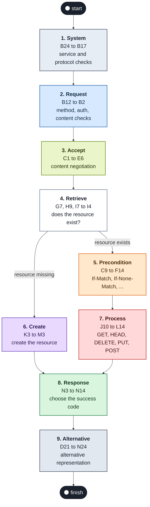
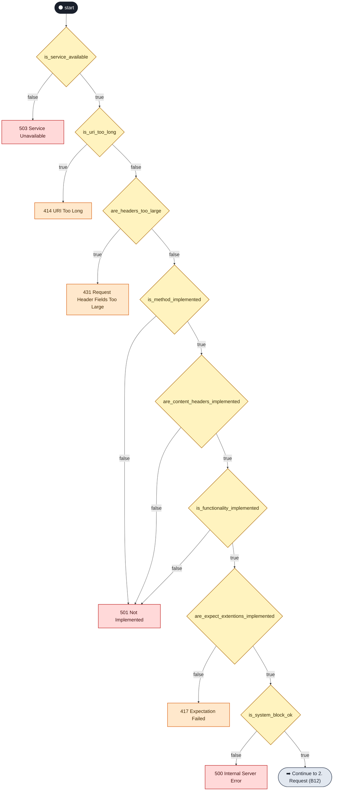
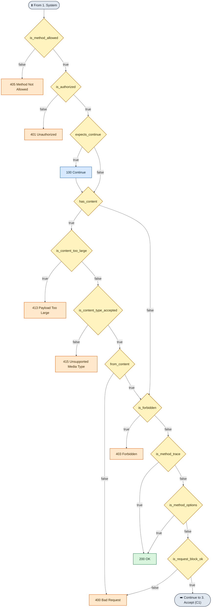
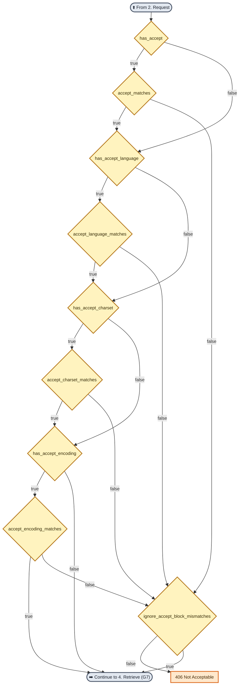
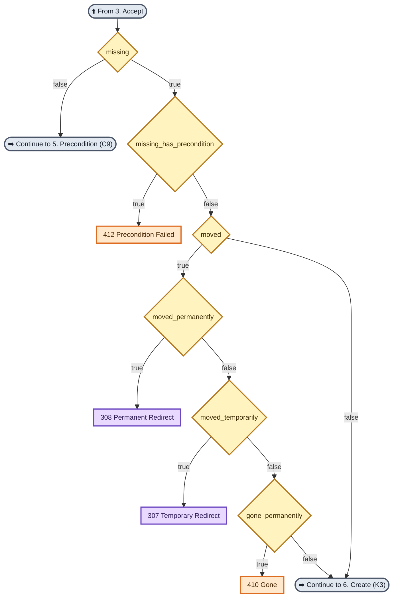
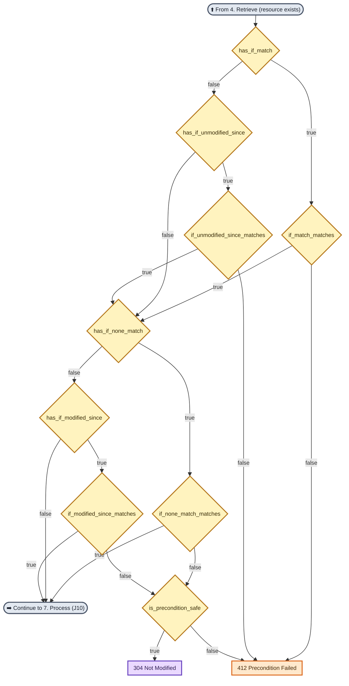
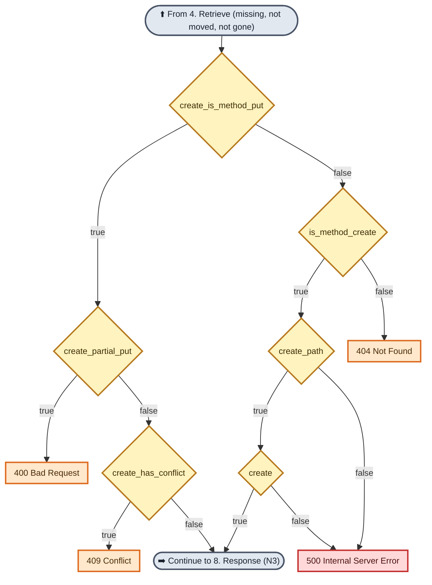
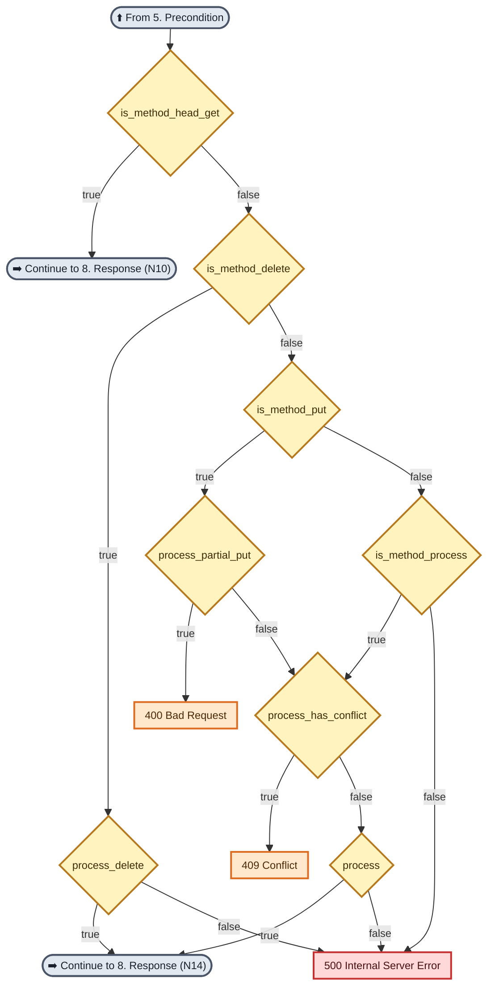
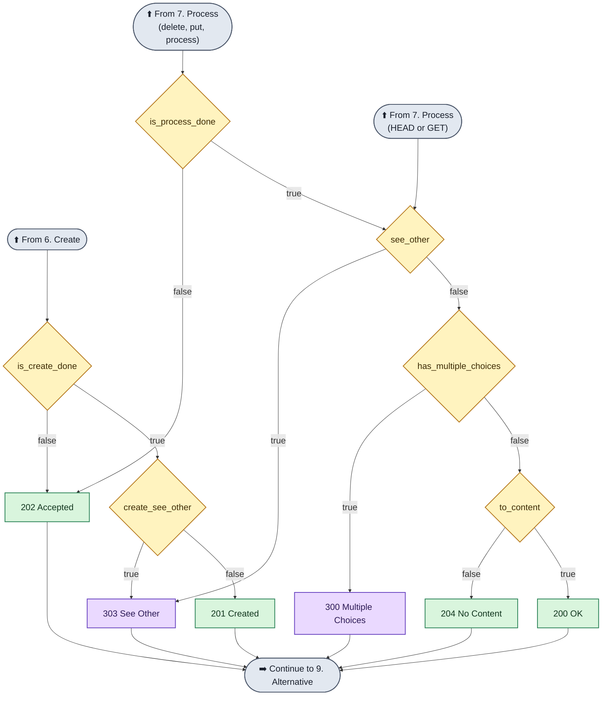
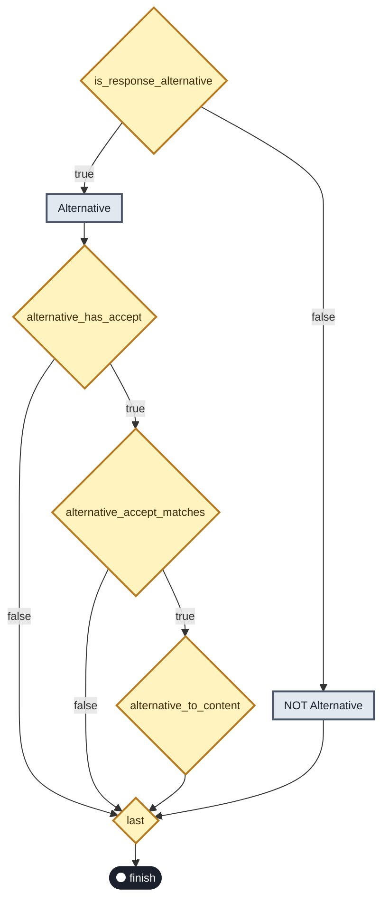

# 🧭 HTTP Decision Diagram (v4.0.201410)

An activity diagram that describes how an HTTP response status code is resolved, given various methods and headers, implemented via semantic callbacks.

The original is one very wide diagram that starts at the bottom and moves up and to the right. Here it is split into **nine stages**, one for each colored region of the original. Every stage is a vertical diagram that reads from the top down. The first diagram shows how the stages connect.

## Table of Contents

- [How to Read the Diagrams](#how-to-read-the-diagrams)
- [Overview: How the Stages Connect](#overview-how-the-stages-connect)
- [1. System](#1-system)
- [2. Request](#2-request)
- [3. Accept](#3-accept)
- [4. Retrieve](#4-retrieve)
- [5. Precondition](#5-precondition)
- [6. Create](#6-create)
- [7. Process](#7-process)
- [8. Response](#8-response)
- [9. Alternative](#9-alternative)
- [Where Each Status Code Comes From](#where-each-status-code-comes-from)

---

## How to Read the Diagrams

| Shape or color | Meaning |
| :--- | :--- |
| 🟨 **Diamond** | A decision (a callback that returns `true` or `false`). The name is the callback name from the original. |
| **Edge label** `true` / `false` | Which way the flow goes. In the original, green arrows are `true` and orange arrows are `false`. |
| 🟦 / 🟩 / 🟪 / 🟧 / 🟥 | Result boxes: 1xx informational, 2xx success, 3xx redirect, 4xx client error, 5xx server error. |
| ⬜ **Rounded box** `➡️ Continue to ...` | The flow goes on to another stage. |

> The original uses the spelling `are_expect_extentions_implemented`. It is kept as written so you can match it to the source.

---

## Overview: How the Stages Connect

Most stages can also stop early by returning an error status code. Those exits are shown inside each stage.

---

## 1. System

Checks that the service and the request can be handled at all. In the original, this is the bottom-left part, read from the bottom up.

---

## 2. Request

Checks the method, authorization and the request body.

---

## 3. Accept

Content negotiation: `Accept`, `Accept-Language`, `Accept-Charset` and `Accept-Encoding`. Any mismatch goes to the `ignore_accept_block_mismatches` decision.

---

## 4. Retrieve

Decides whether the resource exists. If it exists, the flow goes to the preconditions. If it is missing, the flow checks for a precondition and then for a redirect or "gone" result.

---

## 5. Precondition

Conditional request headers for an existing resource: `If-Match`, `If-Unmodified-Since`, `If-None-Match` and `If-Modified-Since`.

---

## 6. Create

For a resource that does not exist: decides whether it can be created (for example by `PUT` or `POST`).

---

## 7. Process

For an existing resource: handles `GET`/`HEAD`, `DELETE`, `PUT` and other processing methods such as `POST`.

---

## 8. Response

Chooses the final success or redirect code. There are three entry points, one from each earlier path.

> The last arrows to "Continue to 9. Alternative" are added to show the flow between stages. The original does not draw a connection from the response boxes to the Alternative region.

---

## 9. Alternative

Decides whether an alternative representation of the response applies. After this, the flow reaches `last` and then `finish`.

---

## Where Each Status Code Comes From

A reverse lookup of the diagrams above. For each status code, it lists the decision that returns it.

| Code | Name | Returned when |
| :-: | :--- | :--- |
| **100** | Continue | `expects_continue` is `true` (the flow then goes on to `has_content`) |
| **200** | OK | `is_method_trace` is `true`, `is_method_options` is `true`, or `to_content` is `true` |
| **201** | Created | `create_see_other` is `false` |
| **202** | Accepted | `is_create_done` is `false`, or `is_process_done` is `false` |
| **204** | No Content | `to_content` is `false` |
| **300** | Multiple Choices | `has_multiple_choices` is `true` |
| **303** | See Other | `create_see_other` is `true`, or `see_other` is `true` |
| **304** | Not Modified | `is_precondition_safe` is `true` |
| **307** | Temporary Redirect | `moved_temporarily` is `true` |
| **308** | Permanent Redirect | `moved_permanently` is `true` |
| **400** | Bad Request | `is_request_block_ok` is `false`, `from_content` is `false`, `create_partial_put` is `true`, or `process_partial_put` is `true` |
| **401** | Unauthorized | `is_authorized` is `false` |
| **403** | Forbidden | `is_forbidden` is `true` |
| **404** | Not Found | `is_method_create` is `false` |
| **405** | Method Not Allowed | `is_method_allowed` is `false` |
| **406** | Not Acceptable | `ignore_accept_block_mismatches` is `false` |
| **409** | Conflict | `create_has_conflict` is `true`, or `process_has_conflict` is `true` |
| **410** | Gone | `gone_permanently` is `true` |
| **412** | Precondition Failed | `if_match_matches` is `false`, `if_unmodified_since_matches` is `false`, `is_precondition_safe` is `false`, or `missing_has_precondition` is `true` |
| **413** | Payload Too Large | `is_content_too_large` is `true` |
| **414** | URI Too Long | `is_uri_too_long` is `true` |
| **415** | Unsupported Media Type | `is_content_type_accepted` is `false` |
| **417** | Expectation Failed | `are_expect_extentions_implemented` is `false` |
| **431** | Request Header Fields Too Large | `are_headers_too_large` is `true` |
| **500** | Internal Server Error | `is_system_block_ok` is `false`, `create_path` is `false`, `create` is `false`, `process_delete` is `false`, `is_method_process` is `false`, or `process` is `false` |
| **501** | Not Implemented | `is_method_implemented` is `false`, `are_content_headers_implemented` is `false`, or `is_functionality_implemented` is `false` |
| **503** | Service Unavailable | `is_service_available` is `false` |

See [HTTP STATUS DETAILS](HTTP%20STATUS%20DETAILS.md) for what each status code means.
