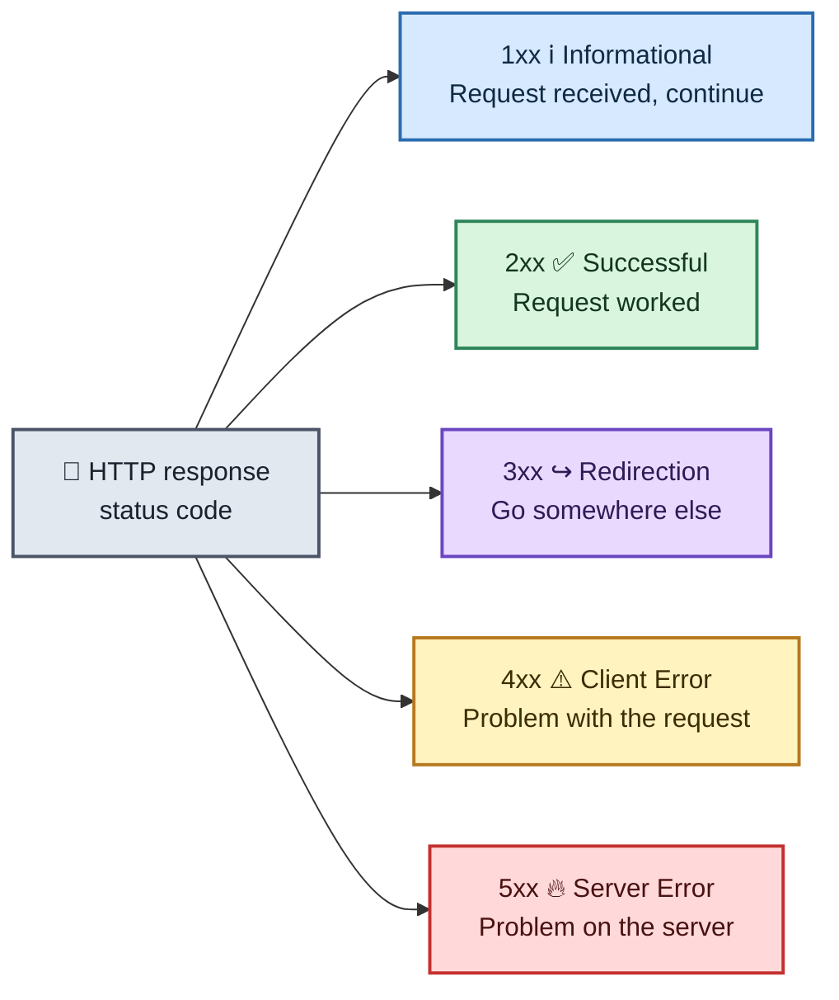
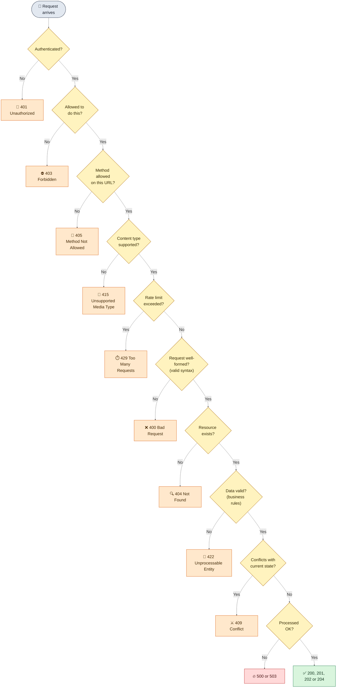

# 🌐 HTTP Status Codes

An HTTP status code is a three-digit number the server sends back with every response. The **first digit** tells you the class of the response.

## Table of Contents

- [Status Code Classes](#status-code-classes)
- [HTTP Status Code Details](#http-status-code-details)
  - [Informational Status Codes](#informational-status-codes)
  - [Client Request Successful](#client-request-successful)
  - [Request Redirected](#request-redirected)
  - [Client Request Incomplete](#client-request-incomplete)
  - [Server Errors](#server-errors)
  - [Unused Status Codes](#unused-status-codes)
- [Most Common HTTP Status Codes](#most-common-http-status-codes)
  - [1xx Informational](#1xx-informational)
  - [2xx Successful](#2xx-successful)
  - [3xx Redirection](#3xx-redirection)
  - [4xx Client Error](#4xx-client-error)
  - [5xx Server Error](#5xx-server-error)
- [Using Status Codes in REST APIs](#using-status-codes-in-rest-apis)
  - [Which Code for Which Operation](#which-code-for-which-operation)
  - [Choosing an Error Code](#choosing-an-error-code)
  - [Commonly Confused Codes](#commonly-confused-codes)
  - [Headers That Go With Status Codes](#headers-that-go-with-status-codes)
  - [Example Responses](#example-responses)
  - [Best Practices](#best-practices)

---

## Status Code Classes



| Class | Meaning | Who is usually responsible |
| :-: | :--- | :--- |
| ℹ️ **1xx** | Informational | Protocol-level, the request is in progress |
| ✅ **2xx** | Successful | Nobody, it worked |
| ↪️ **3xx** | Redirection | The client must take another step |
| ⚠️ **4xx** | Client error | The client, the request is wrong or incomplete |
| 🔥 **5xx** | Server error | The server, it failed to handle a valid request |

---

## HTTP Status Code Details

### Informational Status Codes

| Code | Name | Description |
| :-: | :--- | :--- |
| **100** | Continue | The server is ready to receive the rest of the request. |
| **101** | Switching Protocols | Client specifies that the server should use a certain protocol and the server will give this response when it is ready to switch. |

### Client Request Successful

| Code | Name | Description |
| :-: | :--- | :--- |
| **200** | OK | Success! This is what you want. |
| **201** | Created | Successfully created the URI specified by the client. |
| **202** | Accepted | Accepted for processing but the server has not finished processing it. |
| **203** | Non-Authoritative Information | Information in the response header did not originate from this server. Copied from another server. |
| **204** | No Content | Request is complete without any information being sent back in the response. |
| **205** | Reset Content | Client should reset the current document. Ie. A form with existing values. |
| **206** | Partial Content | Server has fulfilled the partial GET request for the resource. In response to a Range request from the client. Or if someone hits stop. |

### Request Redirected

| Code | Name | Description |
| :-: | :--- | :--- |
| **300** | Multiple Choices | Requested resource corresponds to a set of documents. Server sends information about each one and a URL to request them from so that the client can choose. |
| **301** | Moved Permanently | Requested resource does not exist on the server. A Location header is sent to the client to redirect it to the new URL. Client continues to use the new URL in future requests. |
| **302** | Moved Temporarily | Requested resource has temporarily moved. A Location header is sent to the client to redirect it to the new URL. Client continues to use the old URL in future requests. |
| **303** | See Other | The requested resource can be found in a different location indicated by the Location header, and the client should use the GET method to retrieve it. |
| **304** | Not Modified | Used to respond to the If-Modified-Since request header. Indicates that the requested document has not been modified since the specified date, and the client should use a cached copy. |
| **305** | Use Proxy | The client should use a proxy, specified by the Location header, to retrieve the URL. |
| **307** | Temporary Redirect | The requested resource has been temporarily redirected to a different location. A Location header is sent to redirect the client to the new URL. The client continues to use the old URL in future requests. |

### Client Request Incomplete

| Code | Name | Description |
| :-: | :--- | :--- |
| **400** | Bad Request | The server detected a syntax error in the client's request. |
| **401** | Unauthorized | The request requires user authentication. The server sends the WWW-Authenticate header to indicate the authentication type and realm for the requested resource. |
| **402** | Payment Required | Reserved for future. |
| **403** | Forbidden | Access to the requested resource is forbidden. The request should not be repeated by the client. |
| **404** | Not Found | The requested document does not exist on the server. |
| **405** | Method Not Allowed | The request method used by the client is unacceptable. The server sends the Allow header stating what methods are acceptable to access the requested resource. |
| **406** | Not Acceptable | The requested resource is not available in a format that the client can accept, based on the accept headers received by the server. If the request was not a HEAD request, the server can send Content-Language, Content-Encoding and Content-Type headers to indicate which formats are available. |
| **407** | Proxy Authentication Required | Unauthorized access request to a proxy server. The client must first authenticate itself with the proxy. The server sends the Proxy-Authenticate header indicating the authentication scheme and realm for the requested resource. |
| **408** | Request Time-Out | The client has failed to complete its request within the request timeout period used by the server. However, the client can re-request. |
| **409** | Conflict | The client request conflicts with another request. The server can add information about the type of conflict along with the status code. |
| **410** | Gone | The requested resource is permanently gone from the server. |
| **411** | Length Required | The client must send a Content-Length header in its request. |
| **412** | Precondition Failed | When a client sends a request with one or more If... headers, the server uses this code to indicate that one or more of the conditions specified in these headers is FALSE. |
| **413** | Request Entity Too Large | The server refuses to process the request because its message body is too large. The server can close connection to stop the client from continuing the request. |
| **414** | Request-URI Too Long | The server refuses to process the request, because the specified URI is too long. |
| **415** | Unsupported Media Type | The server refuses to process the request, because it does not support the message body's format. |
| **417** | Expectation Failed | The server failed to meet the requirements of the Expect request-header. |

### Server Errors

| Code | Name | Description |
| :-: | :--- | :--- |
| **500** | Internal Server Error | A server configuration setting or an external program has caused an error. |
| **501** | Not Implemented | The server does not support the functionality required to fulfill the request. |
| **502** | Bad Gateway | The server encountered an invalid response from an upstream server or proxy. |
| **503** | Service Unavailable | The service is temporarily unavailable. The server can send a Retry-After header to indicate when the service may become available again. |
| **504** | Gateway Time-Out | The gateway or proxy has timed out. |
| **505** | HTTP Version Not Supported | The version of HTTP used by the client is not supported. |

### Unused Status Codes

| Code | Name |
| :-: | :--- |
| **306** | Switch Proxy |
| **416** | Requested range not satisfiable |
| **506** | Redirection failed |

---

## Most Common HTTP Status Codes

### 1xx Informational

| Code | Name |
| :-: | :--- |
| **100** | Continue |
| **101** | Switching protocols |
| **102** | Processing |
| **103** | Early Hints |

### 2xx Successful

| Code | Name |
| :-: | :--- |
| **200** | OK |
| **201** | Created |
| **202** | Accepted |
| **203** | Non-Authoritative Information |
| **204** | No Content |
| **205** | Reset Content |
| **206** | Partial Content |
| **207** | Multi-Status |
| **208** | Already Reported |

### 3xx Redirection

| Code | Name |
| :-: | :--- |
| **300** | Multiple Choices |
| **301** | Moved Permanently |
| **302** | Found |
| **303** | See Other |
| **304** | Not Modified |
| **305** | Use Proxy |
| **306** | Switch Proxy |
| **307** | Temporary Redirect |
| **308** | Permanent Redirect |

### 4xx Client Error

| Code | Name |
| :-: | :--- |
| **400** | Bad Request |
| **401** | Unauthorized |
| **402** | Payment required |
| **403** | Forbidden |
| **404** | Not Found |
| **405** | Method Not Allowed |
| **406** | Not Acceptable |
| **407** | Proxy Authentication Required |
| **408** | Request Timeout |
| **409** | Conflict |
| **410** | Gone |
| **411** | Length Required |
| **412** | Precondition Failed |
| **413** | Payload Too Large |
| **414** | URI Too Long |
| **415** | Unsupported Media Type |
| **416** | Range Not Satisfiable |
| **417** | Expectation Failed |
| **418** | I'm a Teapot |
| **421** | Misdirected Request |
| **422** | Unprocessable Entity |
| **423** | Locked |
| **424** | Failed Dependency |
| **425** | Too Early |
| **426** | Upgrade Required |
| **428** | Precondition Required |
| **429** | Too Many Requests |
| **431** | Request Header Fields Too Large |
| **451** | Unavailable For Legal Reasons |

### 5xx Server Error

| Code | Name |
| :-: | :--- |
| **500** | Internal Server Error |
| **501** | Not Implemented |
| **502** | Bad Gateway |
| **503** | Service Unavailable |
| **504** | Gateway Timeout |
| **505** | HTTP Version Not Supported |
| **506** | Variant Also Negotiates |
| **507** | Insufficient Storage |
| **508** | Loop Detected |
| **510** | Not Extended |
| **511** | Network Authentication Required |

---

## Using Status Codes in REST APIs

> This section is an added guide, not part of the two images. It shows which of the codes above a REST API should return, and when.

A REST API uses the status code to tell the client **what happened**, and the response body to give **details**. Clients (and tools like proxies, caches and monitors) rely on the status code, so it should be accurate.

### Which Code for Which Operation

| Operation | ✅ Success | ⚠️ Common errors | Notes |
| :--- | :--- | :--- | :--- |
| **GET** (read) | `200 OK` | `404 Not Found`, `401`, `403` | Use `304 Not Modified` for conditional requests (caching) and `206 Partial Content` for range requests. |
| **POST** (create) | `201 Created` | `400 Bad Request`, `422 Unprocessable Entity`, `409 Conflict` | Send a `Location` header with the URL of the new resource. |
| **POST** (start a long task) | `202 Accepted` | `400`, `422` | The work is not finished. Give the client a way to check the status. |
| **PUT** (replace) | `200 OK` or `204 No Content` | `404`, `409`, `412 Precondition Failed`, `422` | Return `201 Created` if PUT created a new resource. |
| **PATCH** (partial update) | `200 OK` or `204 No Content` | `400`, `404`, `409`, `415`, `422` | Return `200` if you send the updated resource back, `204` if not. |
| **DELETE** | `204 No Content` | `404`, `409`, `401`, `403` | `200` is fine if you return a body. Use `202` if the delete happens later. |
| **Any** (wrong method) | | `405 Method Not Allowed` | Send an `Allow` header listing the allowed methods. |

### Choosing an Error Code

Check the problems in this order. The first one that applies decides the status code.



> The exact order can differ between APIs. For example, some APIs check that the resource exists before checking permissions, so they don't reveal which resources exist.

| Code | Use it when |
| :-: | :--- |
| **400** Bad Request | The request is malformed: broken JSON, a missing required parameter, or the wrong type. |
| **401** Unauthorized | The client is not authenticated: no credentials, or invalid or expired ones. |
| **403** Forbidden | The client is authenticated but is not allowed to do this. |
| **404** Not Found | The resource does not exist (or you don't want to reveal that it does). |
| **405** Method Not Allowed | The URL exists but not for this HTTP method, for example `DELETE` on a read-only resource. |
| **409** Conflict | The request conflicts with the current state, such as a duplicate unique value or an edit of an outdated version. |
| **415** Unsupported Media Type | The request body is in a format the API does not accept. |
| **422** Unprocessable Entity | The JSON is valid, but the data breaks a rule (for example an invalid email address or a negative quantity). |
| **429** Too Many Requests | The client has sent too many requests in a given time. |
| **500** Internal Server Error | An unexpected failure on the server. Don't leak internal details to the client. |
| **502 / 504** | A gateway or proxy got a bad response from, or timed out waiting for, an upstream service. |
| **503** Service Unavailable | The server is temporarily unable to handle requests, for example during maintenance or overload. |

### Commonly Confused Codes

| Pair | The difference |
| :--- | :--- |
| **401 vs 403** | `401` means "I don't know who you are" (log in). `403` means "I know who you are, and you can't do this." |
| **400 vs 422** | `400` means the request could not be understood (syntax). `422` means it was understood, but the values are not valid. Some APIs use `400` for both, which is fine if you use one rule consistently. |
| **404 vs 410** | `404` means not found (it may never have existed). `410` means it existed and is permanently gone. |
| **200 vs 204** | `200` comes with a response body. `204` has no body. |
| **201 vs 202** | `201` means the resource has been created. `202` means the request was accepted and will be processed later. |
| **301 vs 302 vs 307 vs 308** | `301` and `308` are permanent. `302` and `307` are temporary. `307` and `308` keep the HTTP method and body, while `301` and `302` may turn a POST into a GET. |
| **500 vs 503** | `500` is an unexpected bug. `503` is a known, temporary condition, and it can include `Retry-After`. |
| **409 vs 412** | `409` is a conflict with the current state. `412` means a condition in the request headers (such as `If-Match`) was not met. |

### Headers That Go With Status Codes

| Status | Header | Purpose |
| :-: | :--- | :--- |
| `201` | `Location` | URL of the newly created resource. |
| `3xx` | `Location` | Where the client should go next. |
| `401` | `WWW-Authenticate` | Tells the client which authentication scheme to use. |
| `405` | `Allow` | Lists the methods the URL supports. |
| `429`, `503` | `Retry-After` | How long the client should wait before trying again. |
| `304`, `412` | `ETag`, `If-None-Match`, `If-Match` | Conditional requests, for caching and for safe updates. |
| `206` | `Content-Range` | Which part of the resource is in the body. |

### Example Responses

**Created (`POST /users`)**

```http
HTTP/1.1 201 Created
Location: /users/42
Content-Type: application/json

{ "id": 42, "name": "Asha", "email": "asha@example.com" }
```

**Validation error (`422`)**

```http
HTTP/1.1 422 Unprocessable Entity
Content-Type: application/json

{
  "error": "validation_failed",
  "message": "The request data is not valid.",
  "details": [
    { "field": "email", "issue": "Must be a valid email address" },
    { "field": "age", "issue": "Must be 18 or older" }
  ]
}
```

**Not authenticated (`401`)**

```http
HTTP/1.1 401 Unauthorized
WWW-Authenticate: Bearer realm="api"
Content-Type: application/json

{ "error": "unauthorized", "message": "A valid access token is required." }
```

**Rate limited (`429`)**

```http
HTTP/1.1 429 Too Many Requests
Retry-After: 30
Content-Type: application/json

{ "error": "rate_limited", "message": "Too many requests. Try again in 30 seconds." }
```

**Deleted (`DELETE /users/42`)**

```http
HTTP/1.1 204 No Content
```

### Best Practices

- ✅ **Use the standard codes.** Don't invent new ones, and don't use only `200` and `500`.
- ❌ **Don't return `200` with an error in the body.** Clients, caches and monitoring tools look at the status code first.
- 📦 **Always send a useful error body.** Include a machine-readable code, a human-readable message and field details for validation errors. Standard formats such as RFC 9457 "Problem Details" (`application/problem+json`) can be used.
- 🔒 **Don't leak internals.** Never put stack traces, SQL or file paths in a `500` response. Log them on the server.
- 🔁 **Be consistent.** Use the same code for the same situation across all endpoints, and the same error body shape.
- 🧭 **Pick `201` plus `Location` for creation** and `204` for actions with nothing to return.
- ⏳ **Use `202` for long tasks,** and give a status URL the client can poll.
- ⏱️ **Include `Retry-After`** with `429` and `503` so clients know when to retry.
- 🔄 **Make `PUT` and `DELETE` idempotent.** Repeating the same request should leave the same result. Decide whether a repeated `DELETE` returns `204` or `404`, and document it.
- 📝 **Document the status codes** each endpoint can return, for example in your OpenAPI specification.
